<p align="center">
  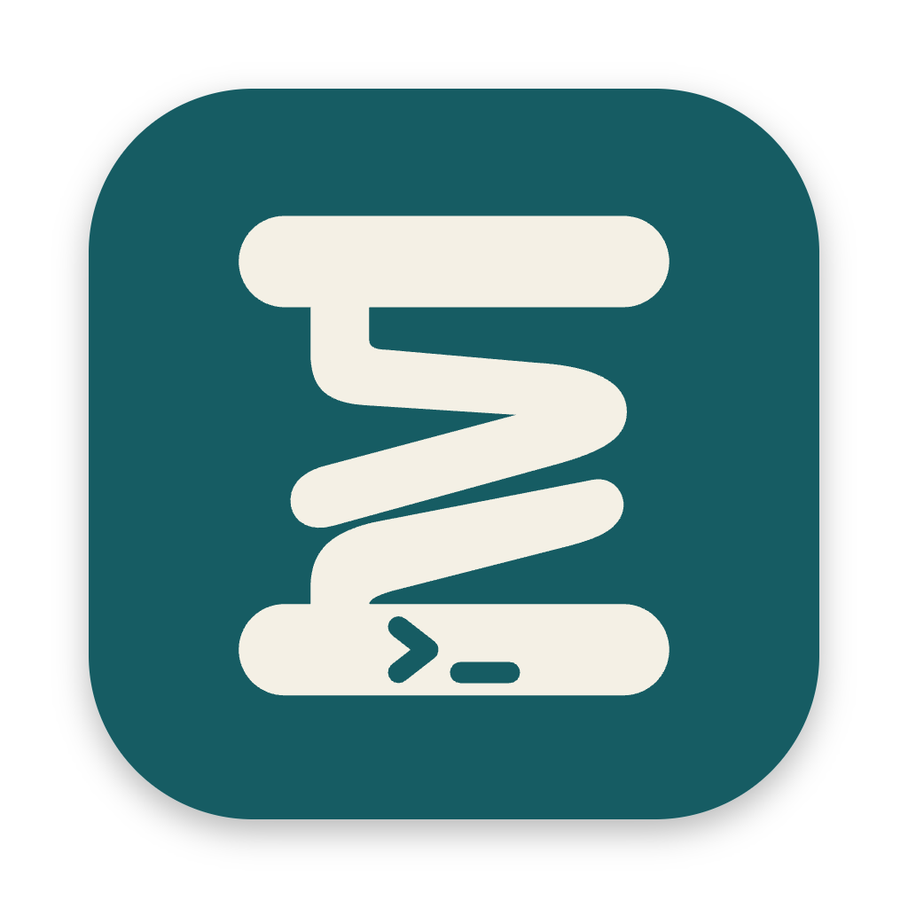
</p>

<h1 align="center">Bobine</h1>

<p align="center">
  <strong>Une application de bureau pour les agents de code ACP : IBM Bob, OpenCode, ou tout
  agent qui parle l'Agent Client Protocol.</strong> macOS, avec Linux et Windows en préversion.<br>
  Converser avec l'agent, approuver chaque modification avec son diff, confier du travail à des
  spécialistes qui avancent en parallèle, et regarder l'agent piloter un navigateur intégré, le
  simulateur iOS ou l'émulateur Android, dans une seule fenêtre.
</p>

<p align="center">
  <a href="https://github.com/jlallement/bobine/releases"></a>
  
  <a href="LICENSE"></a>
  <a href="https://github.com/jlallement/bobine/actions/workflows/ci.yml"></a>
</p>

<p align="center">
  <a href="https://github.com/jlallement/bobine/releases"><strong>Télécharger pour macOS</strong></a> ·
  <a href="#installer">Installer</a> ·
  <a href="docs/guide/fr/README.md">Guide de l'utilisateur</a> ·
  <a href="CHANGELOG.md">Nouveautés</a> ·
  <a href="README.md">English</a>
</p>

<picture>
  <source media="(prefers-color-scheme: dark)" srcset="docs/images/readme/fr/hero-dark.png">
  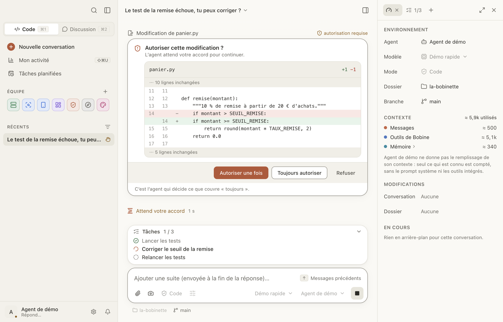
</picture>

<p align="center"><a href="docs/images/readme/fr/demo.mp4">▶ Voir la démo de 20 secondes</a></p>

> **Version 1.0.1.** Bobine sert tous les jours à son auteur, mais encore à peu de monde :
> attendez-vous à des aspérités et [signalez-les](https://github.com/jlallement/bobine/issues/new/choose).
> L'app n'est **pas notarisée par Apple** : macOS demande une étape de plus à la première
> ouverture ([voir Installer](#installer)).

## Pourquoi Bobine

- **Tout agent ACP, une seule fenêtre.** Bobine lance l'agent sur votre Mac et lui donne une vraie
  interface de bureau : réponses en continu, diffs, cartes d'autorisation, plans, historique.
- **IBM Bob d'abord.** SSO ou clé d'API, confiance du dossier, licence et bobcoins dépensés se
  gèrent dans l'app. [OpenCode](https://opencode.ai) marche aussi, avec ses modèles gratuits ou
  vos propres fournisseurs.
- **Vous gardez la main.** Chaque modification ou commande que l'agent demande arrive en carte,
  avec le diff ou la commande exacte, et rien ne part avant votre réponse.
- **Travailler en parallèle.** Appeler des spécialistes (`@security-expert`, `@code-reviewer`…)
  ou laisser l'agent partager le travail : chaque conversation fille avance de son côté, dans le
  dossier ou dans un worktree git.
- **L'agent voit ce qu'il construit.** Navigateur intégré avec console et réseau, terminaux,
  simulateur iOS et émulateur Android, pilotés par l'agent et montrés à côté de la conversation.
- **Aucun modèle dedans.** Bobine n'embarque ni n'appelle aucun modèle, et n'envoie aucune
  télémétrie : votre agent parle à son propre service, avec votre compte ou votre clé.

## Visite

### Approuver chaque modification, avec le diff

L'agent explique ce qu'il a trouvé et demande avant de toucher un fichier. Ensuite, le panneau
**Modifications** montre tout ce que la conversation a changé, fichier par fichier, à côté de la
vue git.

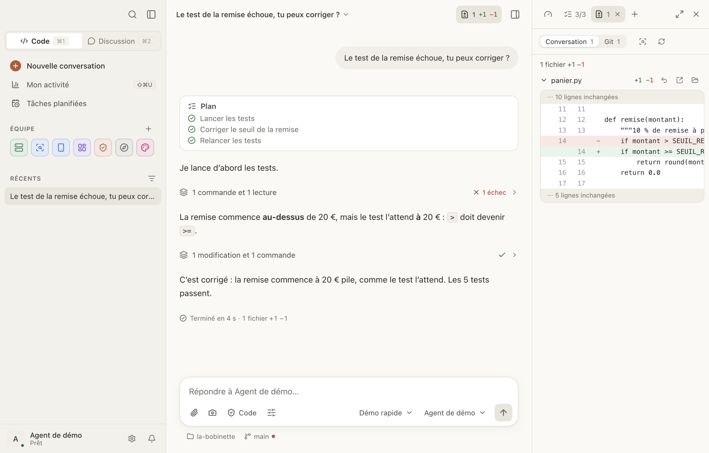

### Confier du travail à des spécialistes

Tapez `@` pour appeler un rôle : sept sont fournis (expert UX/UI, expert sécurité, relecteur de
code, tech lead…), et vous pouvez écrire les vôtres, pour vous ou pour le projet. Chaque rôle
travaille dans sa conversation fille, en parallèle, et rend compte.

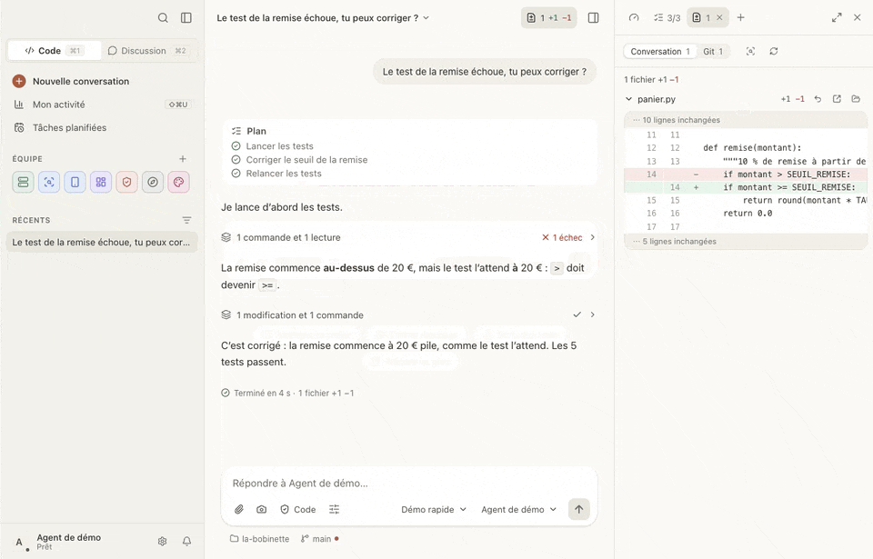

<details>
<summary>Le menu <code>@</code> et les comptes rendus</summary>

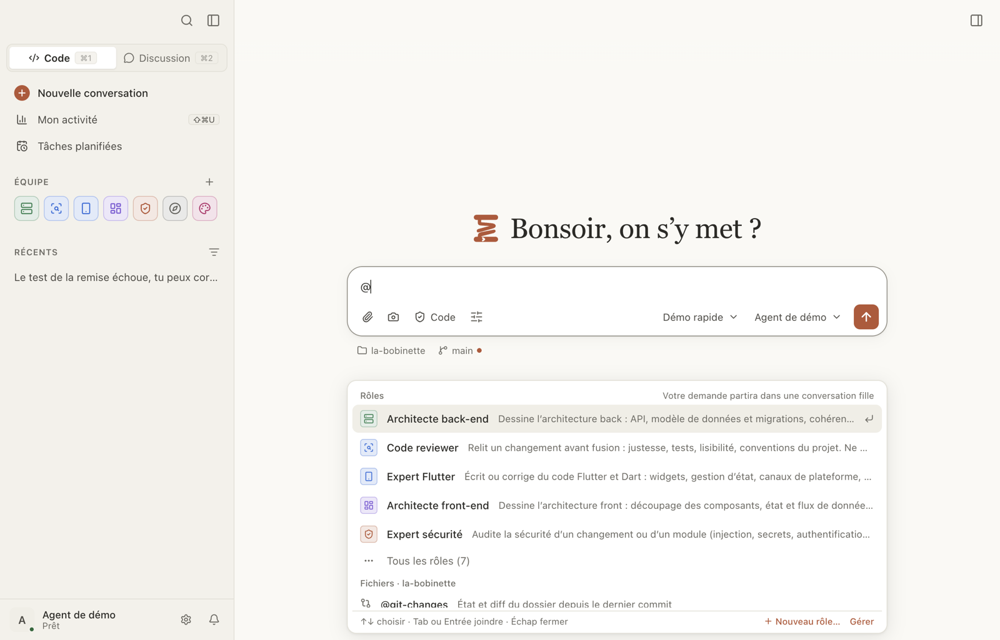

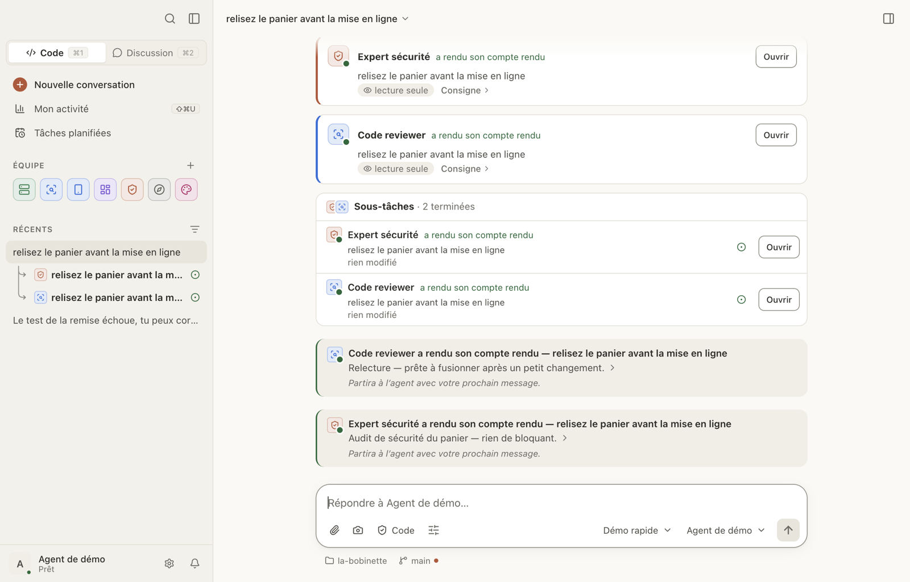

</details>

### L'agent demande plutôt que deviner

Questions à choix, plans à annoter avant que l'agent commence, liste de tâches épinglée au-dessus
de la zone de saisie. Et, comme dans un terminal, **↑** dans une saisie vide rappelle ce que vous
avez déjà envoyé, rôles compris.

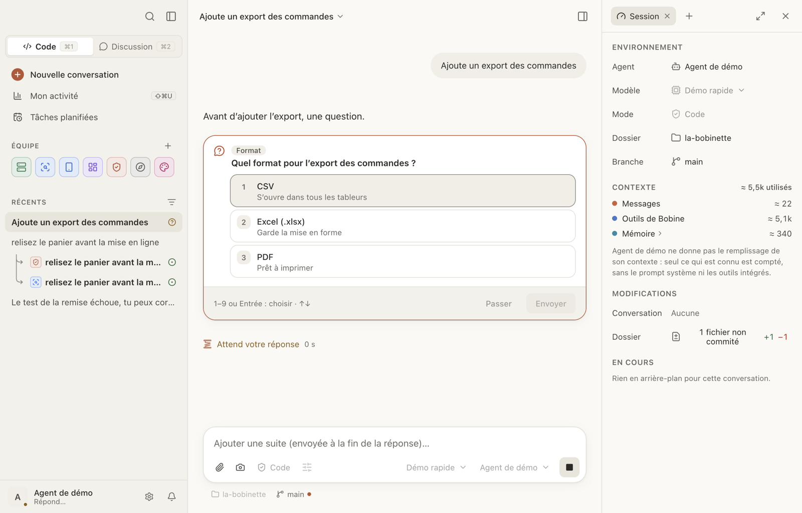

<details>
<summary>L'historique des messages envoyés (↑)</summary>

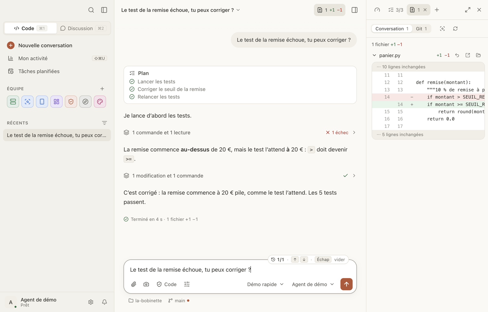

</details>

### Laisser l'agent voir le résultat

L'agent ouvre des pages dans un navigateur intégré (avec console et réseau), et pilote le
simulateur iOS et l'émulateur Android : touchers, lecture de l'écran, planches contact, vidéo.

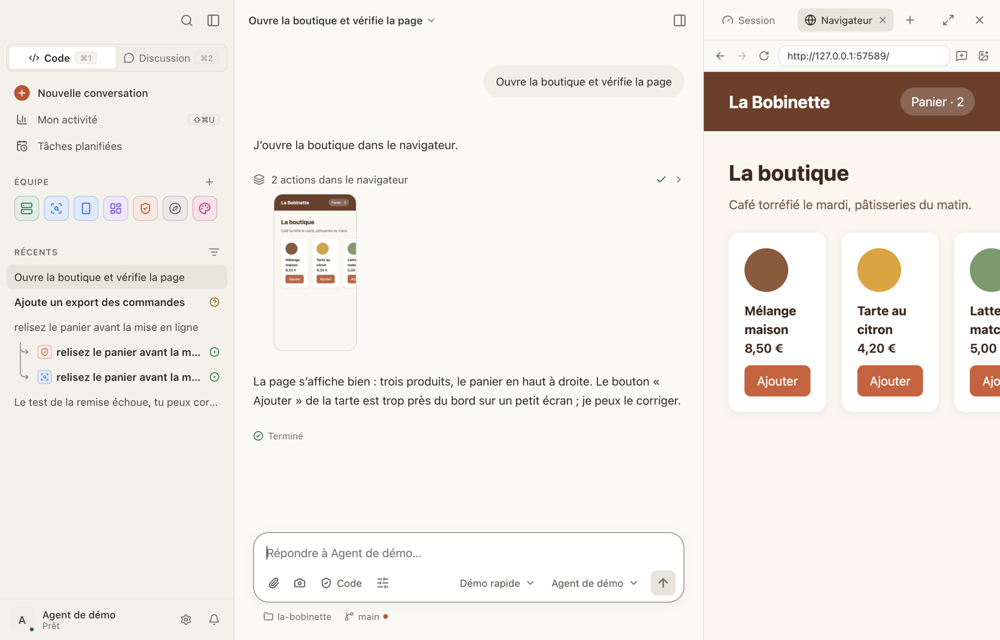

### Discuter, sans projet

Tout n'est pas du code. L'espace **Discussion** garde des conversations sans dossier de projet :
poser une question, faire écrire un e-mail, résumer un document. Ce que l'agent écrit reste dans
l'onglet **Documents** de la discussion, prêt à ouvrir ou à enregistrer.

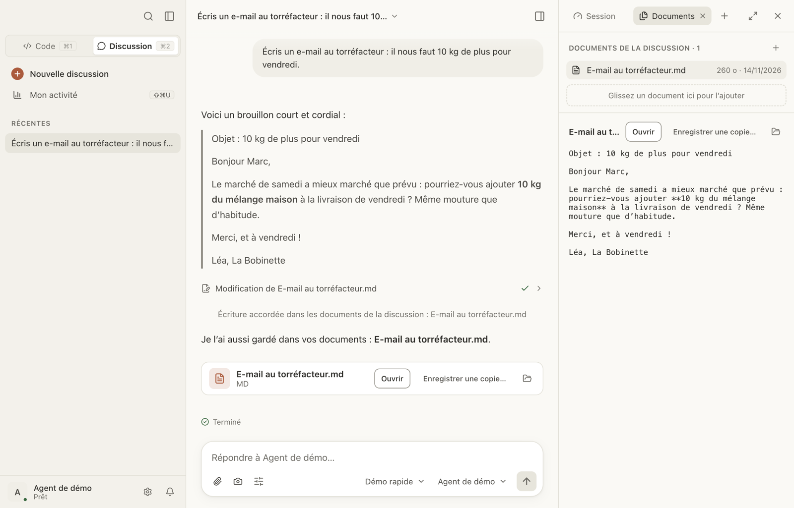

### Clair, sombre et Aurore

Clair et Sombre, Fjord, et **Aurore** et **Aurore nuit** : une base presque neutre et quelques
touches légères (une lueur douce, un dégradé sur vos messages et sur l'action principale, des menus
en verre dépoli). Six accents, la police du système ou la vôtre, une densité compacte et un mode
présentation pour les démonstrations.

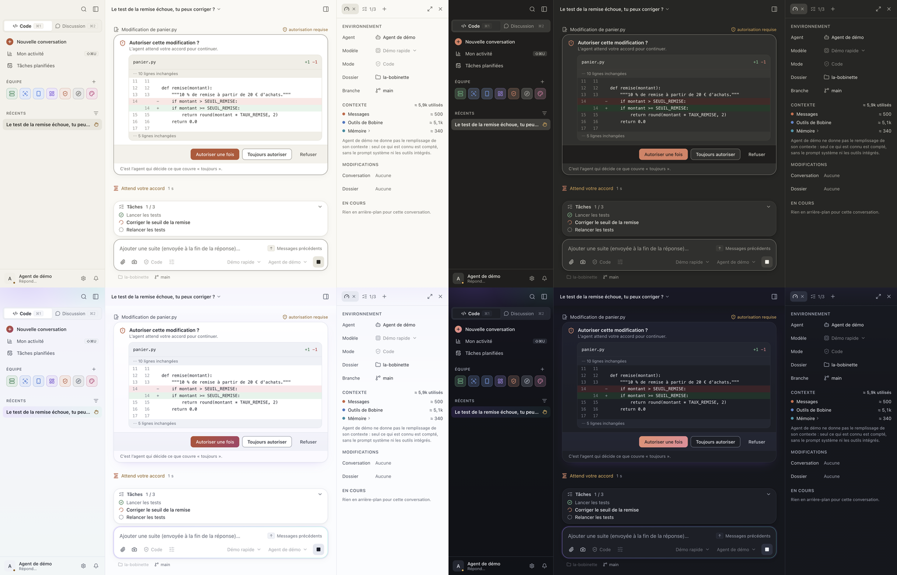

## Agents pris en charge

| Agent | Statut | Versions essayées |
|---|---|---|
| IBM Bob (`bob acp`) | cible principale | 2.0.6, 2.0.9, 2.1.0 |
| OpenCode (`opencode acp`) | pris en charge | 1.19, 2.0.31, 2.0.32, 2.2.5, 2.3.0 |

D'autres agents ACP se déclarent dans Réglages › Agents, sans garantie. Un agent factice sert au
développement et aux essais seulement. Le détail, agent par agent : [`docs/agents.md`](docs/agents.md).
Réglages › Diagnostic prévient quand un agent annonce une version non essayée.

## Installer

**Prérequis :** un Mac Apple Silicon (M1 ou plus récent), **macOS 15 Sequoia ou plus récent**
(le plus ancien macOS sur lequel chaque version est essayée avant publication ; les versions
antérieures refusent de l'ouvrir), et au moins un agent installé (`bob` ou
`opencode` dans le `PATH`).

1. Télécharger `Bobine-<version>-arm64.dmg` sur la page des
   [Releases](https://github.com/jlallement/bobine/releases) (bêtas et versions candidates sont
   marquées « pre-release »).

   **Quelle version ?** Plusieurs lignes se partagent cette page : la 1.0.x, version stable,
   marquée « Latest » ; la 1.1 en versions candidates (`-rc.N`) ; la 1.2 en bêtas (`-beta.N`).
   Prendre la version stable par défaut. Les préversions servent à essayer ce qui arrive, avec
   plus de risque de bugs.
2. Ouvrir le `.dmg` et double-cliquer sur Bobine dans sa fenêtre. C'est le premier lancement, et
   **macOS le bloque** (« Apple n'a pas pu vérifier… ») car l'app est signée ad hoc, pas notarisée
   (choix assumé). Pour passer, selon les [instructions d'Apple](https://support.apple.com/fr-fr/102445) :
   1. Cliquer sur **Terminé** (pas « Placer dans la corbeille »).
   2. Ouvrir **Réglages Système › Confidentialité et sécurité**, descendre jusqu'à la section
      Sécurité et cliquer sur **Ouvrir quand même** à côté du message sur Bobine.
   3. Confirmer avec **Ouvrir** (macOS peut demander le mot de passe ou Touch ID).

   Depuis macOS 15 (Sequoia), Ctrl-clic › Ouvrir ne contourne plus la vérification : « Ouvrir
   quand même » est la voie. Sur un Mac géré par une organisation, ce bouton peut être désactivé
   par sa politique.

   Autre voie en ligne de commande, si vous faites confiance au téléchargement : retirer la marque
   de quarantaine que macOS pose sur un fichier téléchargé par un navigateur, avant d'ouvrir le
   `.dmg`.

   ```bash
   xattr -d com.apple.quarantine ~/Downloads/Bobine-*.dmg
   ```

3. Bobine s'ouvre et propose de s'installer dans `/Applications` ou dans `~/Applications` (sans
   droits d'administrateur) ; la copie installée s'ouvre ensuite normalement. On peut aussi la
   glisser sur Applications : le blocage de l'étape 2 vient alors à sa première ouverture depuis
   là (`xattr -dr com.apple.quarantine /Applications/Bobine.app` en ligne de commande).
4. macOS peut redemander « Enregistrement de l'écran » ou l'accès au trousseau à chaque nouvelle
   version (pour lui, chaque version est une autre app) : choisir « Toujours autoriser ».

Bobine ne se met pas à jour toute seule, mais elle signale qu'une version plus récente existe :
une ligne en bas de la barre latérale, « Bobine X.Y.Z est disponible ». « Voir » ouvre la page de
cette version sur GitHub ; ✕ masque la ligne pour cette version. Rien ne se télécharge ni ne
s'installe : vous installez vous-même le nouveau `.dmg` à la place de l'ancien. Une version stable
n'est avertie que des versions stables plus récentes ; une préversion l'est aussi des préversions
plus récentes de sa ligne. La vérification est active par défaut (voir les
[questions fréquentes](#questions-fréquentes)) ; la couper, ou vérifier tout de suite, dans
Réglages › Nouveautés. On peut aussi suivre les Releases du dépôt sur GitHub (« Watch › Custom ›
Releases »). Derrière un proxy,
sans droits administrateur, ou sans réseau : [`docs/installation.md`](docs/installation.md).

**Linux (préversion).** À partir de la 1.0.0-beta.6, `Bobine-<version>-amd64.deb` (x64) ou
`Bobine-<version>-arm64.deb` sur la [page des versions](https://github.com/jlallement/bobine/releases), pour Ubuntu 24.04 ou plus récent et
Debian : `sudo apt install ./Bobine-<version>-<arch>.deb`. Sommes dans
`SHA256SUMS-linux-x64.txt` ou `-arm64.txt`. Sans les outils du simulateur iOS. Le détail, et la construction
depuis les sources : [`docs/installation.md`](docs/installation.md#linux-préversion).

**Windows (préversion).** À partir de la 1.0.0-beta.6, `Bobine-<version>-x64.exe` ou
`Bobine-<version>-arm64.exe` sur la même page, pour Windows 11 : installée pour l'utilisateur
seul, sans droits d'administrateur. L'installeur n'est pas signé : si SmartScreen avertit,
**Informations complémentaires › Exécuter quand même**. Sommes dans
`SHA256SUMS-windows-<arch>.txt`. Le détail (Smart App Control, désinstallation, construction
depuis les sources) : [`docs/installation.md`](docs/installation.md#windows-préversion).

Quelque chose ne marche pas ? Réglages › Diagnostic vérifie tout d'un coup (agents trouvés,
session d'essai, serveurs MCP, Xcode, simulateurs), avec la marche à suivre pour chaque problème,
et « Signaler un problème » ouvre une issue GitHub préremplie.

## Questions fréquentes

**Bobine envoie-t-elle mon code quelque part ?** Non. Bobine n'a pas de télémétrie et n'appelle
aucun modèle. Elle lance sur votre Mac l'agent que vous avez choisi ; ce qui quitte votre Mac, c'est
ce que cet agent envoie à son propre service. Réglages › Confidentialité et Réglages › Données
montrent ce que Bobine garde sur votre Mac, et permettent de le sauvegarder ou de l'effacer.

**Bobine contacte-t-elle autre chose ?** Une seule : au lancement, une fois par jour au plus, elle
demande à l'API publique de GitHub la liste des versions de Bobine, pour vous dire dans la barre
latérale qu'une version plus récente existe. Elle n'envoie rien sur vous (seulement sa propre version, dans le
`User-Agent`) et n'installe rien. Le réglage est dans Réglages › Nouveautés ou Réglages ›
Confidentialité.

**Faut-il IBM Bob ?** Non. Bob est la cible principale, mais OpenCode marche avec ses modèles
gratuits, et tout agent ACP se déclare dans Réglages › Agents.

**Pourquoi macOS bloque-t-il le premier lancement ?** Bobine est signée ad hoc et n'est pas
notarisée par Apple. Ouvrez-la une fois par **Réglages Système › Confidentialité et sécurité ›
Ouvrir quand même** (voir [Installer](#installer)) ; les sources sont ici, à lire et à construire
vous-même.

**Mac Intel, Linux, Windows ?** Pas de Mac Intel pour l'instant : le `.dmg` est pour Apple
Silicon seulement. Linux (`.deb`) et Windows (installeur), x64 et arm64, sont en préversion sur la
même page des versions (voir [Installer](#installer)).

**Est-ce un fork d'une autre app ?** Non. Elle s'inspire des apps de bureau pour agents de code,
et elle est écrite de zéro avec Electron, React et le
[SDK TypeScript d'ACP](https://github.com/agentclientprotocol/typescript-sdk).

## Feuille de route

- **1.0.x, publiée :** la ligne stable. Corrections venues de l’usage réel et des essayeurs,
  [problèmes connus](https://github.com/jlallement/bobine/milestone/1), compatibilité avec les
  nouvelles versions de Bob et d'OpenCode.
- **1.1, en version candidate :** un onglet Fichiers pour parcourir le dossier de travail et
  commenter une ligne.
- **1.2, en bêta :** le tour de table (`/roundtable`) : la même question part à plusieurs
  modèles, sans qu'aucun ne voie les autres, puis la conversation en fait la synthèse.
- **Idées, pas encore prévues :** revenir avant un tour d'une conversation ; donner la même tâche
  à deux agents et garder le meilleur résultat.

La feuille de route détaillée : [`docs/feuille-de-route-v1.md`](docs/feuille-de-route-v1.md).

## Documentation

- **Guide de l'utilisateur** : [français](docs/guide/fr/README.md) · [English](docs/guide/en/README.md).
- **Documentation du projet** (architecture, ce qu'on utilise d'ACP, agents, installation, agent
  factice, une fiche par fonctionnalité, décisions d'architecture) : [`docs/`](docs/README.md),
  en français.
- Des prompts de démonstration prêts à copier et un petit projet d'essai : [`demos/`](demos/README.md).

## Construire depuis les sources

Pour contribuer, ou pour lancer le dernier `main`. Il faut [Node.js](https://nodejs.org) ≥ 24 et
[pnpm](https://pnpm.io) ≥ 12 (`brew install node pnpm`).

```bash
git clone https://github.com/jlallement/bobine.git && cd bobine
pnpm install
pnpm dev          # lancer en développement (télécharge Electron au premier lancement)
pnpm package      # construire Bobine.app et un .dmg
./scripts/verify  # lint, types, tests unitaires
```

## Contribuer

Les rapports de bogue avec le rapport de diagnostic (Réglages › Diagnostic › « Signaler un
problème ») et les petites corrections bien testées sont les contributions les plus utiles en ce
moment. Lire d'abord [CONTRIBUTING.md](CONTRIBUTING.md) (en anglais) et [AGENTS.md](AGENTS.md) ;
un problème de sécurité passe par [SECURITY.md](SECURITY.md), pas par une issue publique.

Les captures et l'animation de cette page sont faites par un script, contre un agent de démo
scripté, sans modèle ni donnée personnelle : `pnpm build && pnpm vitrine --lang fr`.

## Limites connues

- `.dmg` pour Apple Silicon seulement : pas de version pour Mac Intel. Linux et Windows sont en
  préversion ; l'installeur Windows n'est pas signé (SmartScreen). Les outils du simulateur iOS
  demandent un Mac avec Xcode.
- Signature ad hoc, pas notarisée (voir plus haut) ; macOS 27 n'affiche aucune bannière de
  notification pour une app signée ad hoc (le badge et le rebond du Dock marchent).
- Pas de mise à jour automatique.
- Interface en français et en anglais ; documentation du projet surtout en français.

## Liens

[Nouveautés](CHANGELOG.md) · [Politique de sécurité](SECURITY.md) (en anglais) ·
[Licence](LICENSE) (Apache-2.0) · [Logiciels tiers](THIRD-PARTY-NOTICES.md)

## Marques et absence d'affiliation

Bobine est un projet indépendant. Elle n'est ni affiliée à IBM, au projet OpenCode ou à Anthropic,
ni approuvée ou parrainée par eux. IBM et IBM Bob sont des marques d'International Business
Machines Corporation. OpenCode, Claude et ChatGPT sont des noms ou marques de leurs propriétaires
respectifs. Ces noms ne servent qu'à dire avec quels agents Bobine peut travailler, ou quels
produits l'ont inspirée.
