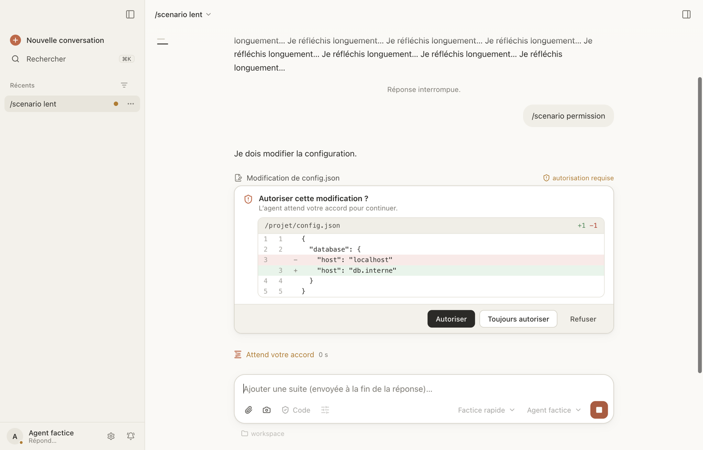

# Bobine

**Une application de bureau macOS pour les agents de code ACP : IBM Bob et OpenCode.** Converser
avec l'agent, approuver ses modifications, et le regarder piloter un navigateur intégré, le
simulateur iOS ou l'émulateur Android, dans une seule fenêtre.

> **Bêta publique (1.0.0-beta.1).** Bobine sert tous les jours à son auteur, mais une seule
> personne l'a utilisée : attendez-vous à des aspérités et [signalez-les](https://github.com/jlallement/bobine/issues/new/choose).
> L'app n'est **pas encore notarisée par Apple** : macOS demande une étape de plus pour
> l'ouvrir ([voir plus bas](#installer)).

[English version](README.md) · [Guide de l'utilisateur](docs/guide/fr/README.md) ·
[Nouveautés](CHANGELOG.md)



## Ce que Bobine est

- Un client de bureau pour tout agent qui parle l'[Agent Client
  Protocol](https://agentclientprotocol.com) (ACP) : l'app lance l'agent, affiche ses réponses en
  continu, ses diffs et ses demandes d'autorisation, et garde l'historique des conversations.
- Pensée d'abord pour **IBM Bob** (`bob acp`) : SSO ou clé d'API, confiance du dossier, licence,
  bobcoins dépensés, tout se passe dans l'app.
- Marche aussi avec **[OpenCode](https://opencode.ai)** (`opencode acp`) : ses modèles gratuits ou
  vos propres fournisseurs.
- Des outils que l'agent utilise à travers l'app : navigateur intégré avec console et réseau,
  terminaux, simulateur iOS (touchers, lecture de l'écran, vidéo) et émulateur Android, questions
  à choix, plans annotés, conversations filles en parallèle dans des worktrees git, suivi de git
  et des pull requests.

Bobine n'est pas un agent : elle n'embarque aucun modèle et n'en appelle aucun. Les agents
s'installent à part et parlent à leurs modèles avec votre propre compte ou clé.

## Agents pris en charge

| Agent | Statut | Versions essayées |
|---|---|---|
| IBM Bob (`bob acp`) | cible principale | 2.0.6, 2.0.9, 2.1.0 |
| OpenCode (`opencode acp`) | pris en charge | 1.19, 2.0.31, 2.0.32, 2.2.5 |

D'autres agents ACP se déclarent dans Réglages › Agents, sans garantie. Un agent factice sert au
développement et aux essais seulement. Le détail, agent par agent : [`docs/agents.md`](docs/agents.md).
Réglages › Diagnostic prévient quand un agent annonce une version non essayée.

## Installer

**Prérequis :** un Mac Apple Silicon (M1 ou plus récent), **macOS 13 Ventura ou plus récent**
(le plancher d'Electron 45, sur lequel l'app est construite ; Bobine ne déclare pas d'autre
minimum et n'est essayée que sur des macOS récents), et au moins un agent installé (`bob` ou
`opencode` dans le `PATH`).

1. Télécharger `Bobine-<version>-arm64.dmg` sur la page des
   [Releases](https://github.com/jlallement/bobine/releases) (la bêta est marquée
   « pre-release »).
2. Ouvrir le `.dmg`, puis double-cliquer sur Bobine dans sa fenêtre : elle propose de s'installer
   dans `/Applications` ou dans `~/Applications` (sans droits d'administrateur). On peut aussi la
   glisser sur Applications.
3. Ouvrir Bobine. **Le premier lancement est bloqué** (« Apple n'a pas pu vérifier… ») car l'app
   est signée ad hoc, pas notarisée. Pour passer, selon les [instructions
   d'Apple](https://support.apple.com/fr-fr/102445) :
   1. Essayer d'ouvrir l'app une fois, puis cliquer sur **Terminé** (pas « Placer dans la
      corbeille »).
   2. Ouvrir **Réglages Système › Confidentialité et sécurité**, descendre jusqu'à la section
      Sécurité et cliquer sur **Ouvrir quand même** à côté du message sur Bobine.
   3. Confirmer avec **Ouvrir** (macOS peut demander le mot de passe ou Touch ID).

   Ensuite, Bobine s'ouvre normalement. Depuis macOS 15 (Sequoia), Ctrl-clic › Ouvrir ne
   contourne plus la vérification : « Ouvrir quand même » est la voie. Sur un Mac géré par une
   organisation, ce bouton peut être désactivé par sa politique.

   Autre voie en ligne de commande, si vous faites confiance au téléchargement : retirer la marque
   de quarantaine que macOS pose sur un fichier téléchargé par un navigateur.

   ```bash
   xattr -dr com.apple.quarantine /Applications/Bobine.app
   ```

4. macOS peut redemander « Enregistrement de l'écran » ou l'accès au trousseau à chaque nouvelle
   version (pour lui, chaque version est une autre app) : choisir « Toujours autoriser ».

Bobine ne se met pas à jour toute seule : suivre les Releases du dépôt sur GitHub (« Watch ›
Custom › Releases ») et installer chaque nouveau `.dmg` à la place de l'ancien. Derrière un proxy,
sans droits administrateur, ou sans réseau : [`docs/installation.md`](docs/installation.md).

**Linux (préversion, expérimentale).** AppImage et `.deb` construits sous Linux, sans les outils du
simulateur iOS ([fiche 145](docs/features/145-preversion-linux.md)). Ils ne sont pas publiés avec
cette bêta : pour l'instant, construire depuis les sources sous Linux (plus bas).

Quelque chose ne marche pas ? Réglages › Diagnostic vérifie tout d'un coup (agents trouvés,
session d'essai, serveurs MCP, Xcode, simulateurs), avec la marche à suivre pour chaque problème,
et « Signaler un problème » ouvre une issue GitHub préremplie.

## Documentation

- **Guide de l'utilisateur** : [français](docs/guide/fr/README.md) · [English](docs/guide/en/README.md).
- **Documentation du projet** (architecture, ce qu'on utilise d'ACP, agents, installation, agent
  factice, une fiche par fonctionnalité, décisions d'architecture) : [`docs/`](docs/README.md),
  en français.
- Des prompts de démonstration prêts à copier et un petit projet d'essai : [`demos/`](demos/README.md).

## Construire depuis les sources

Pour contribuer, ou pour lancer le dernier `main`. Il faut [Node.js](https://nodejs.org) ≥ 24 et
[pnpm](https://pnpm.io) ≥ 12 (`brew install node pnpm`).

```bash
git clone https://github.com/jlallement/bobine.git && cd bobine
pnpm install
pnpm dev          # lancer en développement (télécharge Electron au premier lancement)
pnpm package      # construire Bobine.app et un .dmg
./scripts/verify  # lint, types, tests unitaires
```

Règles pour contribuer : [CONTRIBUTING.md](CONTRIBUTING.md) (en anglais) et [AGENTS.md](AGENTS.md).

## Limites connues

- `.dmg` pour Apple Silicon seulement : pas de version Intel ni Windows ; les outils du simulateur
  iOS demandent Xcode.
- Signature ad hoc, pas notarisée (voir plus haut) ; macOS 27 n'affiche aucune bannière de
  notification pour une app signée ad hoc (le badge et le rebond du Dock marchent).
- Pas de mise à jour automatique.
- Interface en français et en anglais ; documentation du projet surtout en français.

## Liens

[Nouveautés](CHANGELOG.md) · [Politique de sécurité](SECURITY.md) (en anglais) ·
[Licence](LICENSE) (Apache-2.0) · [Logiciels tiers](THIRD-PARTY-NOTICES.md)

## Marques et absence d'affiliation

Bobine est un projet indépendant. Elle n'est ni affiliée à IBM, au projet OpenCode ou à Anthropic,
ni approuvée ou parrainée par eux. IBM et IBM Bob sont des marques d'International Business
Machines Corporation. OpenCode, Claude et ChatGPT sont des noms ou marques de leurs propriétaires
respectifs. Ces noms ne servent qu'à dire avec quels agents Bobine peut travailler, ou quels
produits l'ont inspirée.
