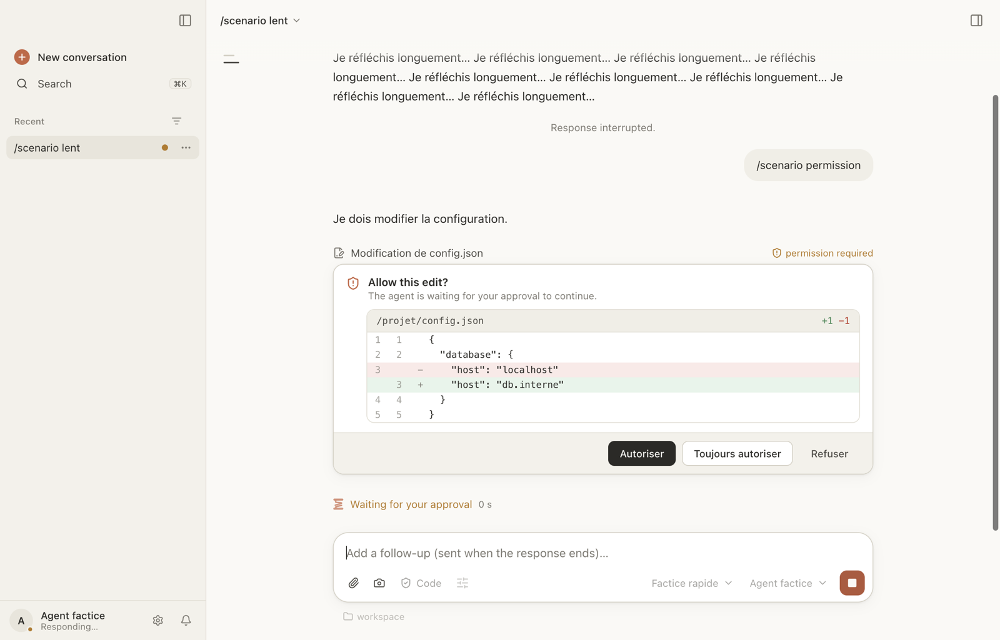

# Bobine

**A macOS desktop app for ACP coding agents: IBM Bob and OpenCode.** Chat with the agent, approve
its changes, and watch it drive a built-in browser, an iOS Simulator or an Android emulator, all
in one window.

> **Public beta (1.0.0-beta.1).** Bobine works daily for its author, but it has had one user so
> far: expect rough edges and please [report issues](https://github.com/jlallement/bobine/issues/new/choose).
> The app is **not notarized by Apple** yet, so macOS needs one extra step to open it
> ([see below](#install)).

[Version française](README.fr.md) · [User guide](docs/guide/en/README.md) ·
[What's new](CHANGELOG.en.md)



## What Bobine is

- A desktop client for any agent that speaks the
  [Agent Client Protocol](https://agentclientprotocol.com) (ACP): the app starts the agent,
  streams its replies, shows diffs and permission requests, and keeps the conversation history.
- Made first for **IBM Bob** (`bob acp`): SSO or API key, folder trust, license and bobcoins spent
  are all handled in the app.
- Also works with **[OpenCode](https://opencode.ai)** (`opencode acp`): its free models, or your
  own providers.
- Tools the agent can use through the app: a built-in browser with console and network panes,
  terminals, the iOS Simulator (taps, screen reading, video) and the Android emulator, questions
  with choices, annotated plans, child conversations working in parallel in git worktrees, git
  and pull-request follow-up.

Bobine is not an agent: it embeds no model and calls none. The agents are installed separately,
and talk to their own models with your own account or key.

## Supported agents

| Agent | Status | Versions tested |
|---|---|---|
| IBM Bob (`bob acp`) | main target | 2.0.6, 2.0.9, 2.1.0 |
| OpenCode (`opencode acp`) | supported | 1.19, 2.0.31, 2.0.32, 2.2.5 |

Other ACP agents can be declared in Settings › Agents, without any guarantee. A mock agent is
used for development and tests only. Details, agent by agent: [`docs/agents.md`](docs/agents.md)
(French). Settings › Diagnostics warns when an agent reports a version that has not been tested.

## Install

**Requirements:** a Mac with Apple Silicon (M1 or later), **macOS 13 Ventura or later** (the floor
of Electron 45, on which the app is built; Bobine declares no other minimum and is only tested on
recent macOS), and at least one agent installed (`bob` or `opencode` in your `PATH`).

1. Download `Bobine-<version>-arm64.dmg` from the
   [Releases page](https://github.com/jlallement/bobine/releases) (the beta is marked as a
   pre-release).
2. Open the `.dmg`, then double-click Bobine in its window: it offers to install itself in
   `/Applications` or in `~/Applications` (no administrator rights needed). You can also drag it
   onto Applications.
3. Open Bobine. **The first launch is blocked** (« Apple could not verify… ») because the app is
   signed ad hoc, not notarized. The way through, following
   [Apple's instructions](https://support.apple.com/en-us/102445):
   1. Try to open the app once, then click **Done** (not « Move to Trash »).
   2. Open **System Settings › Privacy & Security**, scroll down to the Security section and
      click **Open Anyway** next to the Bobine message.
   3. Confirm with **Open** (macOS may ask for your password or Touch ID).

   From then on, Bobine opens normally. On macOS 15 (Sequoia) and later, Control-click › Open no
   longer bypasses the check; Open Anyway above is the way. If a Mac is managed by an
   organization, the button may be disabled by its policy.

   Command-line alternative, if you trust the download: remove the quarantine mark that macOS puts
   on files downloaded by a browser.

   ```bash
   xattr -dr com.apple.quarantine /Applications/Bobine.app
   ```

4. macOS may ask again for Screen Recording or keychain access after each new version (each
   build is a different app for it): choose « Always Allow ».

Bobine does not update itself: watch the repository's Releases on GitHub (« Watch › Custom ›
Releases ») and install each new `.dmg` over the old one. Behind a proxy, without administrator
rights, or offline: [`docs/installation.md`](docs/installation.md) (French).

**Linux (preview, experimental).** AppImage and `.deb` packages, built on Linux, without the iOS
Simulator tools ([sheet 145](docs/features/145-preversion-linux.md), French). They are not published
with this beta: for now, build from source on Linux (below).

Something does not work? Settings › Diagnostics checks everything at once (agents found, trial
session, MCP servers, Xcode, simulators), with the fix for each problem, and « Report an issue »
opens a prefilled GitHub issue.

## Documentation

- **User guide**: [English](docs/guide/en/README.md) · [français](docs/guide/fr/README.md).
- **Project documentation** (architecture, what the app uses of ACP, agents, installation, mock
  agent, one feature sheet per feature, architecture decisions) is in [`docs/`](docs/README.md)
  and is written **in French**; the entry pages (this file, `CONTRIBUTING.md`, `SECURITY.md`)
  are in English.
- Ready-to-copy demo prompts and a small sample project: [`demos/`](demos/README.md).

## Build from source

For contributors, or to run the latest `main`. You need [Node.js](https://nodejs.org) ≥ 24 and
[pnpm](https://pnpm.io) ≥ 12 (`brew install node pnpm`).

```bash
git clone https://github.com/jlallement/bobine.git && cd bobine
pnpm install
pnpm dev          # run in development (downloads the Electron binary on first run)
pnpm package      # build Bobine.app and a .dmg
./scripts/verify  # lint, typecheck, unit tests
```

Rules for contributions: [CONTRIBUTING.md](CONTRIBUTING.md) and [AGENTS.md](AGENTS.md).

## Known limitations

- Apple Silicon only for the `.dmg`: no Intel, no Windows build; the iOS Simulator tools need
  Xcode.
- Ad hoc signature, not notarized (see above); macOS 27 shows no notification banner for an ad
  hoc signed app (the Dock badge and bounce still work).
- No automatic updates.
- Interface in English and French; project documentation mostly in French.

## Links

[What's new](CHANGELOG.en.md) · [Security policy](SECURITY.md) · [License](LICENSE) (Apache-2.0)
· [Third-party notices](THIRD-PARTY-NOTICES.md)

## Trademarks and non-affiliation

Bobine is an independent project. It is not affiliated with, endorsed by or sponsored by IBM,
the OpenCode project or Anthropic. IBM and IBM Bob are trademarks of International
Business Machines Corporation. OpenCode, Claude and ChatGPT are names or trademarks of their
respective owners. These names are used only to say which agents Bobine can work with, or which
products inspired it.
