<p align="center">
  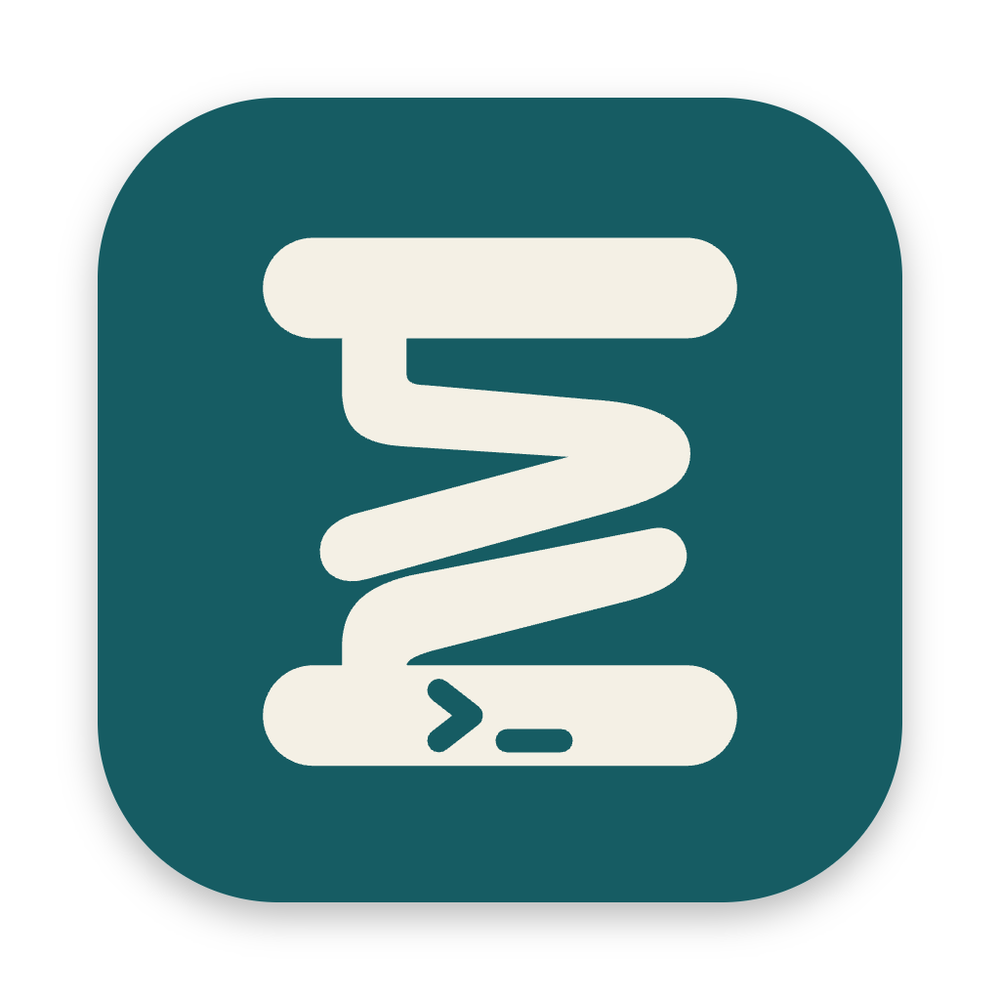
</p>

<h1 align="center">Bobine</h1>

<p align="center">
  <strong>A desktop app for ACP coding agents: IBM Bob, OpenCode, or any agent that speaks the
  Agent Client Protocol.</strong> macOS, with Linux and Windows in preview.<br>
  Chat with the agent, approve each change with its diff, hand work to specialists running in
  parallel, and watch the agent drive a built-in browser, the iOS Simulator or an Android
  emulator, all in one window.
</p>

<p align="center">
  <a href="https://github.com/jlallement/bobine/releases"></a>
  
  <a href="LICENSE"></a>
  <a href="https://github.com/jlallement/bobine/actions/workflows/ci.yml"></a>
</p>

<p align="center">
  <a href="https://github.com/jlallement/bobine/releases"><strong>Download for macOS</strong></a> ·
  <a href="#install">Install</a> ·
  <a href="docs/guide/en/README.md">User guide</a> ·
  <a href="CHANGELOG.en.md">What's new</a> ·
  <a href="README.fr.md">Français</a>
</p>

<picture>
  <source media="(prefers-color-scheme: dark)" srcset="docs/images/readme/en/hero-dark.png">
  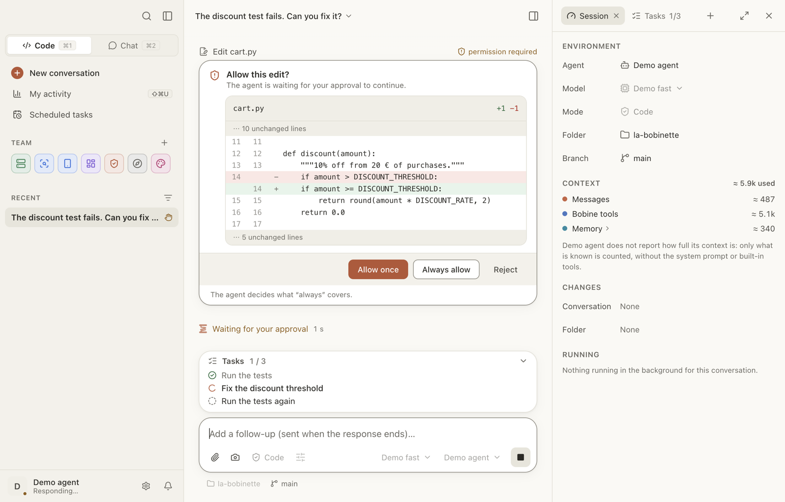
</picture>

<p align="center"><a href="docs/images/readme/en/demo.mp4">▶ Watch the 20-second demo</a></p>

> **Version 1.0.1.** Bobine is used every day by its author, but by few people so far: expect rough
> edges and please [report them](https://github.com/jlallement/bobine/issues/new/choose). The app
> is **not notarized by Apple**, so macOS asks for one extra step the first time you open it
> ([see Install](#install)).

## Why Bobine

- **Any ACP agent, one window.** Bobine starts the agent on your Mac and gives it a real desktop
  interface: streamed answers, diffs, permission cards, plans, history.
- **IBM Bob first.** SSO or API key, folder trust, license and bobcoins spent are handled in the
  app. [OpenCode](https://opencode.ai) works too, with its free models or your own providers.
- **You stay in control.** Every edit and command the agent asks for shows up as a card with the
  diff or the exact command, and nothing runs until you answer.
- **Work in parallel.** Call specialists (`@security-expert`, `@code-reviewer`…) or let the agent
  split the work: each child conversation runs on its own, in the folder or in a git worktree.
- **The agent can see what it builds.** A built-in browser with console and network, terminals,
  the iOS Simulator and the Android emulator, all driven by the agent and shown next to the
  conversation.
- **No model inside.** Bobine embeds no model and calls none, and has no telemetry: your agent
  talks to its own service, with your own account or key.

## A tour

### Approve each change, with the diff

The agent explains what it found and asks before touching a file. Afterwards, the **Changes**
panel shows everything the conversation changed, file by file, next to the git view.

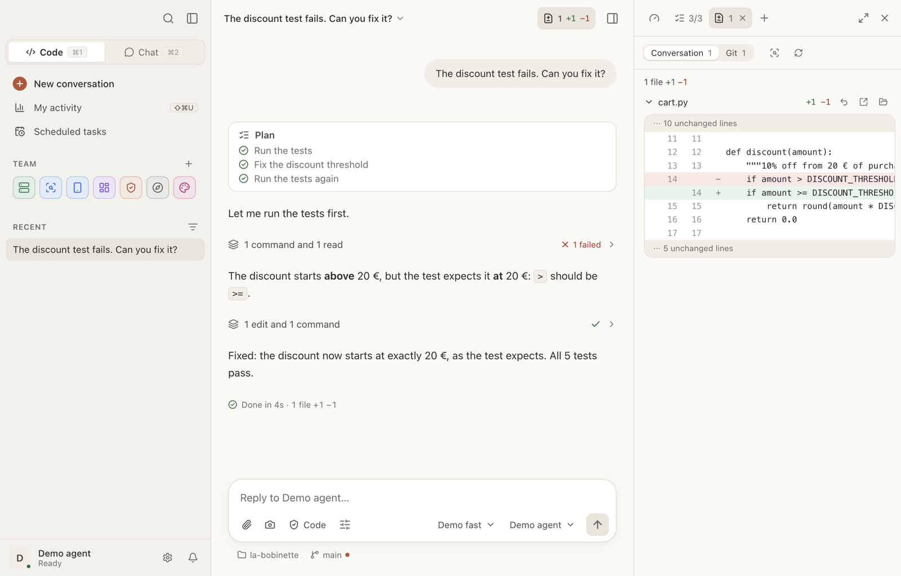

### Hand work to specialists

Type `@` to call a role: seven are built in (UX/UI expert, security expert, code reviewer, tech
lead…), and you can write your own, for you or for the project. Each role works in its own child
conversation, in parallel, and reports back.

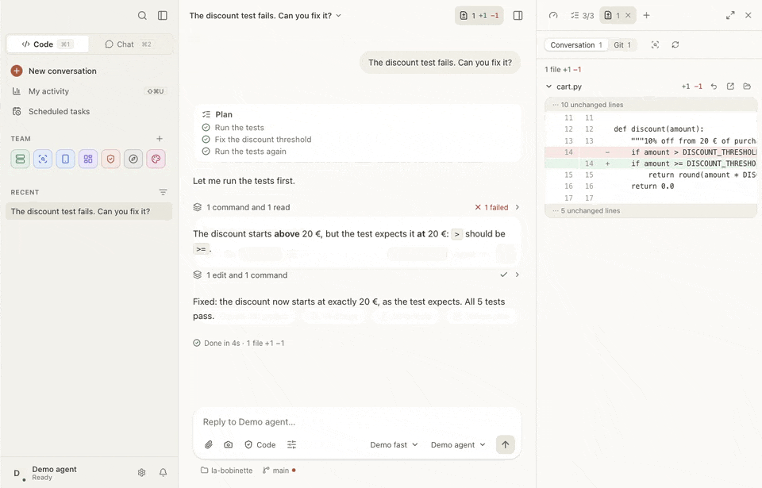

<details>
<summary>The <code>@</code> menu and the reports</summary>

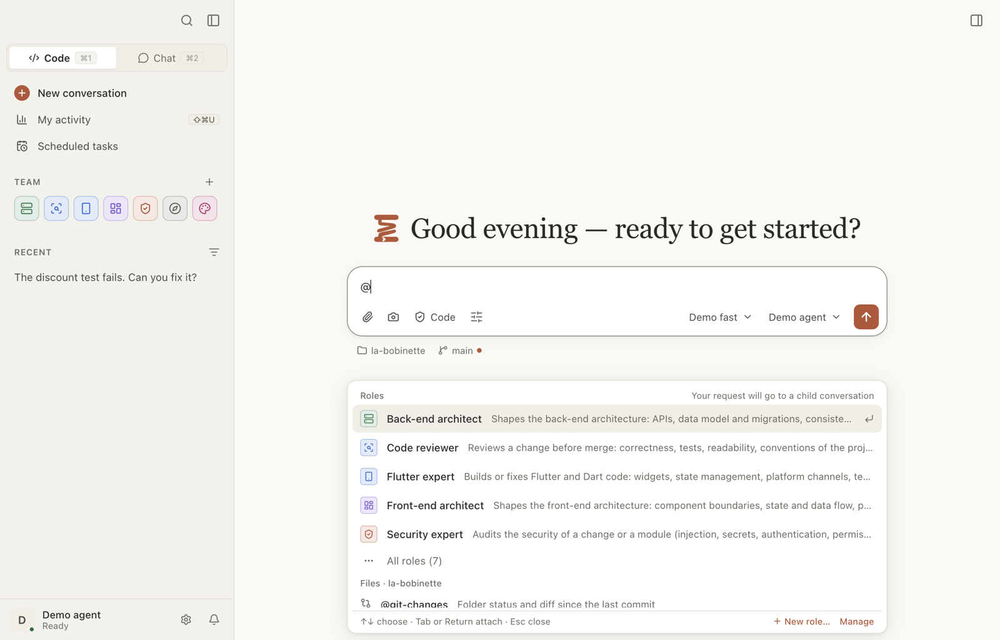

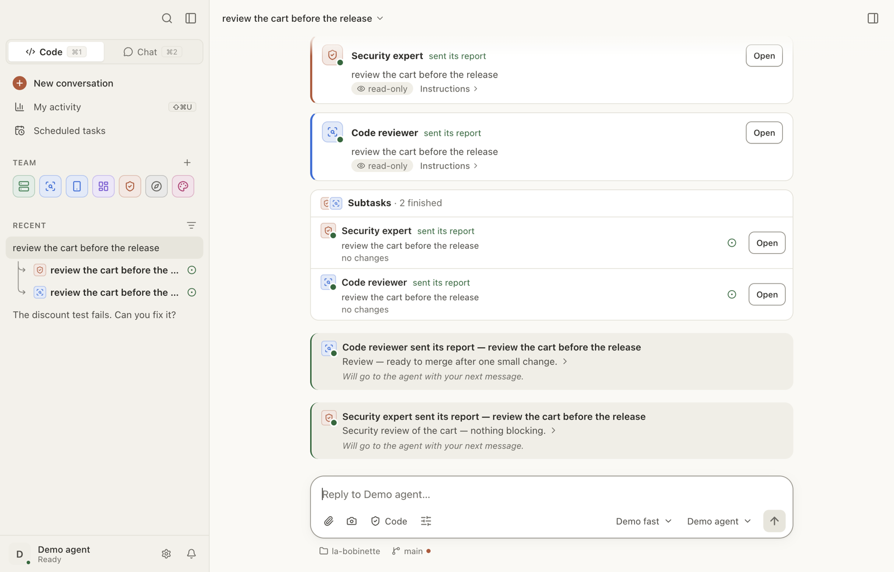

</details>

### The agent asks before guessing

Questions with choices, plans you can annotate before the agent starts, a task list pinned above
the message box. And, as in a terminal, **↑** in an empty message box brings back what you sent
before, roles included.

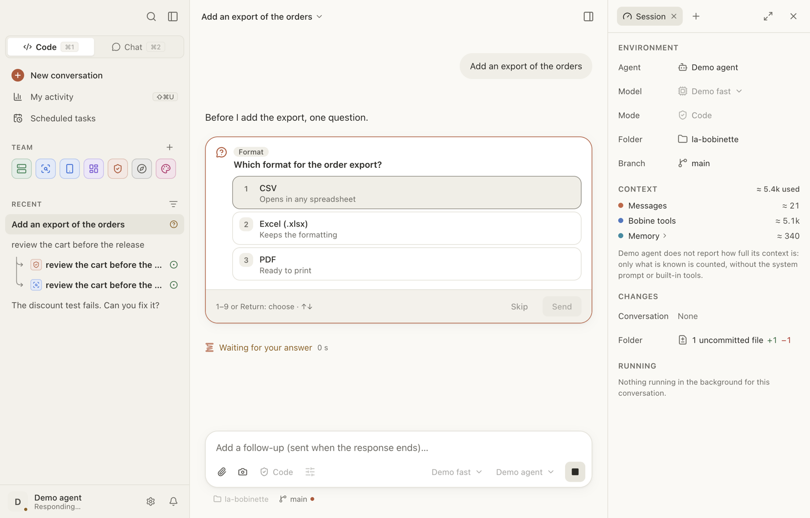

<details>
<summary>The sent-message history (↑)</summary>

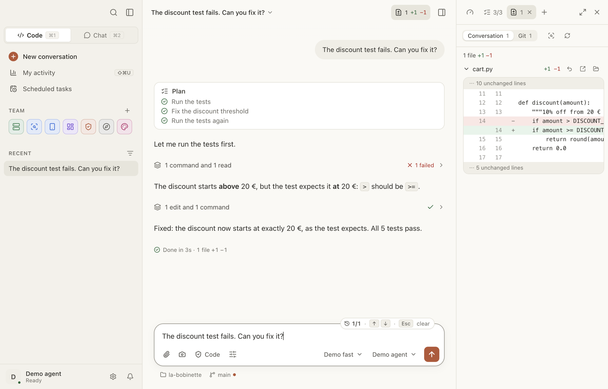

</details>

### Let the agent see the result

The agent opens pages in a built-in browser (with console and network), and drives the iOS
Simulator and the Android emulator: taps, screen reading, contact sheets, video.

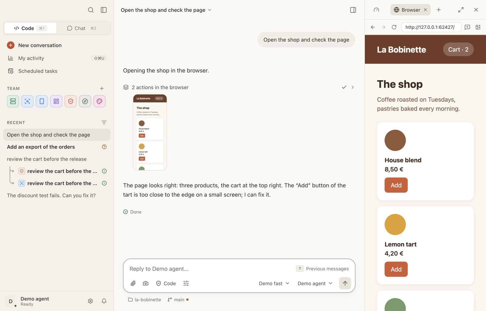

### Chat, without a project

Not everything is code. The **Chat** space holds conversations without a project folder: ask a
question, write an email, summarize a document. What the agent writes is kept in the chat's
**Documents** tab, ready to open or save.

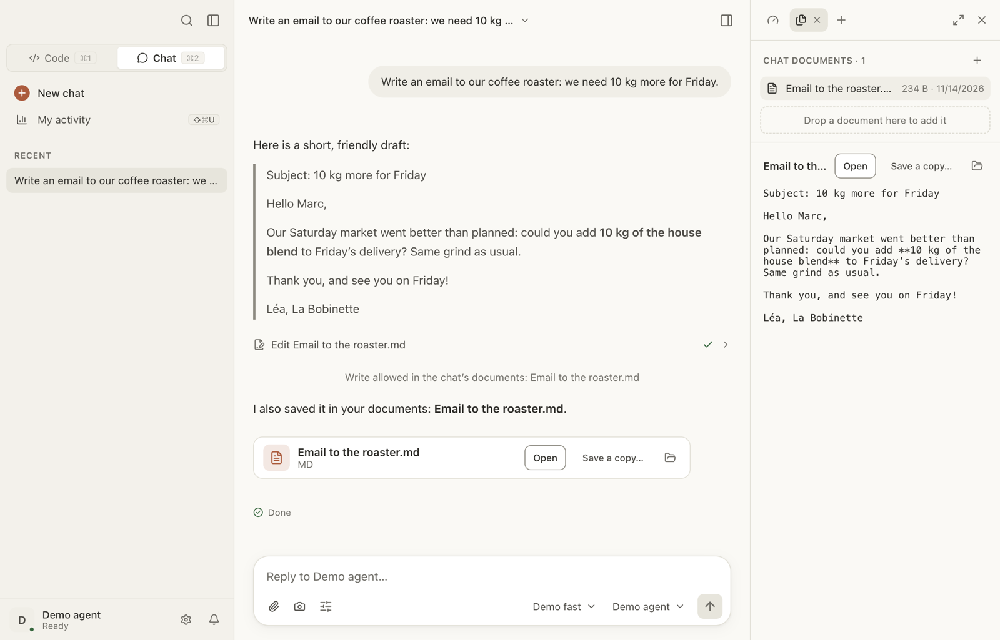

### Light, dark and Aurora

Light and Dark, Fjord, and **Aurora** and **Aurora Night**: a near-neutral base with a few light
touches (a soft glow, a gradient on your messages and on the main action, frosted menus). Six
accents, the system font or your own, a compact density and a presentation mode for demos.

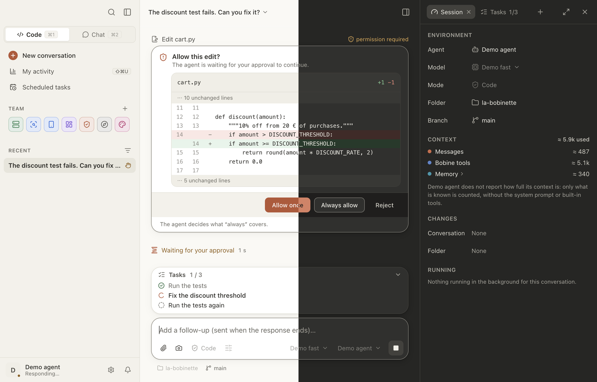

## Supported agents

| Agent | Status | Versions tested |
|---|---|---|
| IBM Bob (`bob acp`) | main target | 2.0.6, 2.0.9, 2.1.0 |
| OpenCode (`opencode acp`) | supported | 1.19, 2.0.31, 2.0.32, 2.2.5, 2.3.0 |

Other ACP agents can be declared in Settings › Agents, without any guarantee. Details, agent by
agent: [`docs/agents.md`](docs/agents.md) (French). Settings › Diagnostics warns when an agent
reports a version that has not been tested.

## Install

**Requirements:** a Mac with Apple Silicon (M1 or later), **macOS 15 Sequoia or later** (the
oldest macOS each release is tried on before it is published; earlier versions refuse to open it), and at least one agent installed (`bob` or `opencode` in your `PATH`).

1. Download `Bobine-<version>-arm64.dmg` from the
   [Releases page](https://github.com/jlallement/bobine/releases) (betas and release candidates
   are marked as pre-releases).

   **Which version?** Several lines share that page: 1.0.x, the stable version, marked
   « Latest »; 1.1 in release candidates (`-rc.N`); 1.2 in betas (`-beta.N`). Take the stable
   version by default. Pre-releases are there to try what is coming, with more risk of bugs.
2. Open the `.dmg` and double-click Bobine in its window. This is the first launch, and **macOS
   blocks it** (« Apple could not verify… ») because the app is signed ad hoc, not notarized
   (a deliberate choice). The way through, following
   [Apple's instructions](https://support.apple.com/en-us/102445):
   1. Click **Done** (not « Move to Trash »).
   2. Open **System Settings › Privacy & Security**, scroll down to the Security section and
      click **Open Anyway** next to the Bobine message.
   3. Confirm with **Open** (macOS may ask for your password or Touch ID).

   On macOS 15 (Sequoia) and later, Control-click › Open no longer bypasses the check; Open
   Anyway above is the way. If a Mac is managed by an organization, the button may be disabled
   by its policy.

   Command-line alternative, if you trust the download: remove the quarantine mark that macOS puts
   on files downloaded by a browser, before opening the `.dmg`.

   ```bash
   xattr -d com.apple.quarantine ~/Downloads/Bobine-*.dmg
   ```

3. Bobine opens and offers to install itself in `/Applications` or in `~/Applications` (no
   administrator rights needed); the installed copy then opens normally. You can also drag
   Bobine onto Applications instead: the block of step 2 then comes when you first open it from
   there (`xattr -dr com.apple.quarantine /Applications/Bobine.app` on the command line).
4. macOS may ask again for Screen Recording or keychain access after each new version (each
   build is a different app for it): choose « Always Allow ».

Bobine does not update itself, but it tells you when a newer version exists: a line at the
bottom of the sidebar, « Bobine X.Y.Z is available ». « View » opens that release's page on
GitHub; ✕ hides the line for that version. Nothing is downloaded or installed: you install the new
`.dmg` over the old one yourself. A stable version is told only of newer stable versions; a
pre-release also of newer pre-releases of its own line. The check is on by default (see the
[FAQ](#faq)); turn it off, or check now, in Settings › What's new. You can also watch the
repository's Releases on GitHub (« Watch › Custom › Releases »). Behind a proxy, without administrator
rights, or offline: [`docs/installation.md`](docs/installation.md) (French).

**Linux (preview).** From 1.0.0-beta.6, `Bobine-<version>-amd64.deb` (x64) or `Bobine-<version>-arm64.deb`
on the [Releases page](https://github.com/jlallement/bobine/releases), for Ubuntu 24.04 or later and Debian:
`sudo apt install ./Bobine-<version>-<arch>.deb`. Checksums in `SHA256SUMS-linux-x64.txt` or `-arm64.txt`. No
iOS Simulator tools. Details, and building from source:
[`docs/installation.md`](docs/installation.md#linux-préversion) (French).

**Windows (preview).** From 1.0.0-beta.6, `Bobine-<version>-x64.exe` or
`Bobine-<version>-arm64.exe` on the same page, for Windows 11: installed for the current user,
without administrator rights. The installer is not signed: if SmartScreen warns, choose **More
info › Run anyway**. Checksums in `SHA256SUMS-windows-<arch>.txt`. Details (Smart App Control,
uninstalling, building from source): [`docs/installation.md`](docs/installation.md#windows-préversion)
(French).

Something does not work? Settings › Diagnostics checks everything at once (agents found, trial
session, MCP servers, Xcode, simulators), with the fix for each problem, and « Report an issue »
opens a prefilled GitHub issue.

## FAQ

**Does Bobine send my code anywhere?** No. Bobine has no telemetry and calls no model. It starts
the agent you chose on your Mac; what leaves your Mac is what that agent sends to its own service.
Settings › Privacy and Settings › Data show what Bobine keeps on your Mac, and let you back it
up or erase it.

**Does Bobine contact anything else?** One thing only: at launch, at most once a day, it asks
GitHub's public API for the list of Bobine releases, to tell you in the sidebar when a newer
version exists. It
sends nothing about you (just its own version, in the `User-Agent`), and installs nothing. Turn it
off in Settings › What's new or Settings › Privacy.

**Do I need IBM Bob?** No. Bob is the main target, but OpenCode works with its free models, and
any ACP agent can be declared in Settings › Agents.

**Why does macOS block the first launch?** Bobine is signed ad hoc and not notarized by Apple.
Open it once through **System Settings › Privacy & Security › Open Anyway** (see
[Install](#install)); the source is here to read and build yourself.

**Intel Mac, Linux, Windows?** No Intel Mac for now: the `.dmg` is for Apple Silicon only. Linux
(`.deb`) and Windows (installer), x64 and arm64, are in preview on the same Releases page (see
[Install](#install)).

**Is it a fork of another app?** No. It is inspired by desktop apps for coding agents, and built
from scratch on Electron, React and the
[ACP TypeScript SDK](https://github.com/agentclientprotocol/typescript-sdk).

## Roadmap

- **1.0.x, published:** the stable line. Fixes from real use and testers,
  [known issues](https://github.com/jlallement/bobine/milestone/1), compatibility with new
  versions of Bob and OpenCode.
- **1.1, in release candidate:** a Files tab to browse the working folder and comment on a line.
- **1.2, in beta:** Roundtable (`/roundtable`): the same question goes to several models, none
  seeing the others, then the conversation gives a synthesis.
- **Ideas, not scheduled:** rewind a conversation to before a turn; give the same task to two
  agents and keep the best result.

The detailed roadmap (French) is in [`docs/feuille-de-route-v1.md`](docs/feuille-de-route-v1.md).

## Documentation

- **User guide**: [English](docs/guide/en/README.md) · [français](docs/guide/fr/README.md).
- **Project documentation** (architecture, what the app uses of ACP, agents, installation, mock
  agent, one feature sheet per feature, architecture decisions) is in [`docs/`](docs/README.md)
  and is written **in French**; the entry pages (this file, `CONTRIBUTING.md`, `SECURITY.md`)
  are in English.
- Ready-to-copy demo prompts and a small sample project: [`demos/`](demos/README.md).

## Build from source

For contributors, or to run the latest `main`. You need [Node.js](https://nodejs.org) ≥ 24 and
[pnpm](https://pnpm.io) ≥ 12 (`brew install node pnpm`).

```bash
git clone https://github.com/jlallement/bobine.git && cd bobine
pnpm install
pnpm dev          # run in development (downloads the Electron binary on first run)
pnpm package      # build Bobine.app and a .dmg
./scripts/verify  # lint, typecheck, unit tests
```

## Contributing

Bug reports with the diagnostic report (Settings › Diagnostics › « Report an issue ») and small,
well-tested fixes are the most useful contributions right now. Read
[CONTRIBUTING.md](CONTRIBUTING.md) and [AGENTS.md](AGENTS.md) first; security problems go through
[SECURITY.md](SECURITY.md), not a public issue.

The screenshots and the animation on this page are made by a script, against a scripted demo
agent, without any model or personal data: `pnpm build && pnpm vitrine`.

## Known limitations

- Apple Silicon only for the `.dmg`: no Intel Mac build. Linux and Windows are previews; the
  Windows installer is not signed (SmartScreen). The iOS Simulator tools need a Mac with Xcode.
- Ad hoc signature, not notarized (see above); macOS 27 shows no notification banner for an ad
  hoc signed app (the Dock badge and bounce still work).
- No automatic updates.
- Interface in English and French; project documentation mostly in French.

## Links

[What's new](CHANGELOG.en.md) · [Security policy](SECURITY.md) · [License](LICENSE) (Apache-2.0)
· [Third-party notices](THIRD-PARTY-NOTICES.md)

## Trademarks and non-affiliation

Bobine is an independent project. It is not affiliated with, endorsed by or sponsored by IBM,
the OpenCode project or Anthropic. IBM and IBM Bob are trademarks of International
Business Machines Corporation. OpenCode, Claude and ChatGPT are names or trademarks of their
respective owners. These names are used only to say which agents Bobine can work with, or which
products inspired it.
