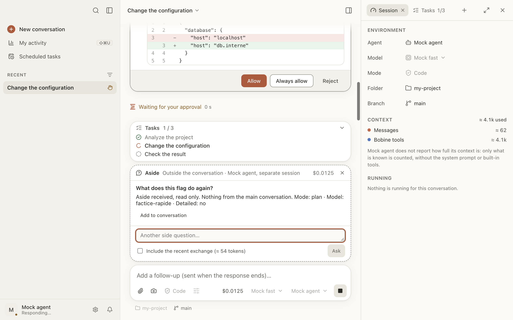

# Aside

An aside is a question asked on the side of the conversation: “what was that flag again?”, “what
does this function do?”. The same agent answers it in a separate, read-only session. Nothing is
added to the conversation, or to what the agent remembers of it. It works even while the agent is
working, and before the first message.

Here you can:

- [ask a side question](#poser);
- [give it the conversation’s context](#contexte);
- [copy the answer into the conversation](#ajouter-au-fil);
- learn [what an aside costs](#cout).

## Ask a side question

Either:

- type `/btw` followed by your question in the message box, then ↩;
- ⇧⌘A, or the Conversation › **Aside…** menu, then write the question and click **Ask**.

The **Aside** card opens above the message box, marked “Outside the conversation”. The answer
arrives there. You can ask more questions in the same card: the aside keeps its session.

To close the aside: ✕ on the card, or Esc. Its session is then deleted on the agent’s side.

**Read-only.** The aside’s agent can’t change anything: every permission request is refused
automatically, and the card says so (“The agent wanted to change something: refused…”). With an
agent that never asks for permission, only the read-only instruction holds it back.

## Give it the conversation’s context

By default, the aside gets nothing from the conversation: it sees the folder, not the exchange. To
let it know what you’re talking about, check **Include the recent exchange**: the end of the
conversation (about 2,000 tokens at most; the estimate is shown) goes with the question.

While the box is checked, this excerpt is included with **every** question of the aside.

## Copy the answer into the conversation

Under an answer, **Add to conversation** copies the question and the answer into the message box,
as a quote. Nothing is sent: reread, add to it, then send it if you want. The aside closes.

## What an aside costs

The aside’s cost shows on its card and is counted in the conversation’s cost (and toward its cap).
Including the recent exchange costs more, on every question.

An agent that only reports tokens, with no cost, adds nothing to the conversation’s cost.
