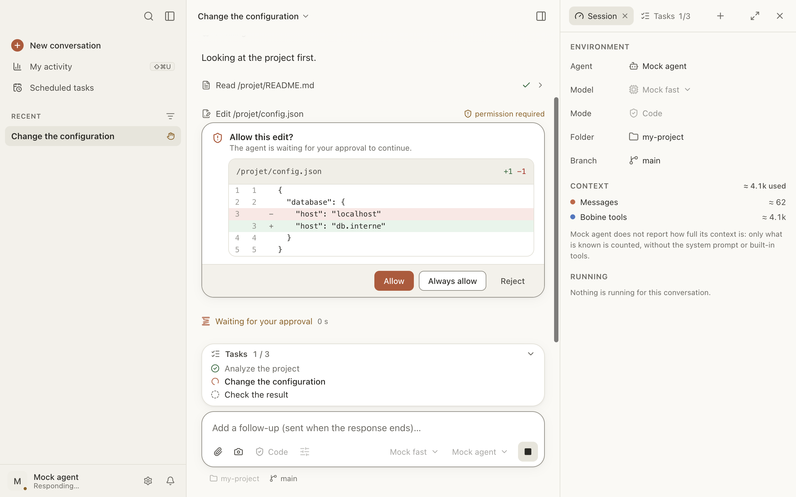

# Conversations and permissions

Everything happens in the conversation: you write, the agent responds and works, and Bobine asks
for your approval when needed.

Here you can:

- [answer a permission request](#autorisations);
- [find and revoke an “always” approval](#accords-retenus);
- [answer the agent’s questions](#questions);
- [stop the agent](#arreter) or [write to it while it works](#file-d-attente);
- [attach files and images](#pieces-jointes), [mention a file](#mentions),
  [run a slash command](#commandes);
- [review and comment on a plan](#plan);
- [branch from a message](#repartir);
- [find a conversation](#historique) and [search inside it](#rechercher);
- [keep track of what a conversation costs](#cout).

## Answer a permission request

When the agent wants to change a file, delete one or run a command, it may ask for your approval.
A card appears in the conversation (“Allow this edit?”, “Allow this command?”…), and the
conversation is marked **Waiting for your answer** in the sidebar.

The buttons are the agent’s own: with IBM Bob, “Allow once”, “Always allow” and “Reject”. The
first one is highlighted.

**What gets asked depends on the agent.** IBM Bob asks before writing and before running a
command. OpenCode, by default, asks nothing. See [Agents](agents.md#autorisations).

**Bobine’s tools.** When the agent uses Bobine’s tools (opening a site in the built-in browser,
running a command in the terminal, building, launching the app), Bobine asks, and you always see
the exact command:

- for a site: **Allow** (for this conversation), **Always allow** (remembered on this Mac) or
  **Deny**;
- for a command or a build: **Run** or **Build**, **Always in this project** (without asking
  again in this folder) or **Deny**.

A denied tool is marked “refused” in the conversation.

## Find and revoke an “always” approval

Settings › Privacy › **Allowed without asking** lists what you allowed once and for all: tools,
sites, commands per folder, worktree setup. **Revoke** removes it; the agent will ask again.

Bobine never remembers, from one conversation to the next, an “always” given to an edit, a
deletion, a move or a command of the agent.

## Answer the agent’s questions

The agent may ask you a multiple-choice question: click an answer, type its number (1–9), or
write your own in **Other…**. Several questions follow one another in tabs: **Next**, **Skip**,
then **Send**.

It may also ask you to fill in a form (**Send** or **Decline**), or to open a page in your
browser.

## Stop the agent

While it works, the send button turns into a square: click it, or press Esc, or ⌘. (Conversation
menu › Stop Response). The conversation shows “Response interrupted.”, and the running tool
“interrupted”.

If a command hasn’t produced any output for a few minutes, its card says so (“No output for
3 min”) with **Interrupt**. The delay is set in Settings › Conversations.

## Write while the agent works

Write in the message box (“Add a follow-up…”) and press ↩: the message waits above the message
box and is sent when the response ends. Several queued messages are sent together, as one.

On a queued message: **Send now** (interrupts the agent and sends it), **Edit** (or ↑ in an empty
message box), **Remove**.

For a question that shouldn’t go into the conversation: an [aside](aparte.md).

## Attach files and images

Drag files onto the conversation, paste an image, or click the paper clip: **Attach files…** or
**Capture an area of the screen**. At most 10 attachments per message, and 5 MB per image. An
attached image can be annotated before sending.

A long pasted text (more than 40 lines or 4,000 characters) becomes a “Pasted text” attachment;
**Put back in the message** puts it back into the message.

With IBM Bob, an excluded file (`.gitignore`, `.bobignore`, `.env`) asks for confirmation: Bob
wouldn’t open it itself.

## Mention a file with @

Type `@` and the start of a name: Bobine suggests files from the folder. ↩ or ⇥ attaches the file
to the message.

Two special mentions:

- `@git-changes`: the folder’s status and diff since the last commit;
- `@terminal`: the last lines of the conversation’s terminal.

## Run a slash command

At the start of a message, type `/`: the list of commands opens. Bobine’s commands work with
every agent:

| Command | What it does |
|---|---|
| `/clear` | New conversation, same agent and same folder |
| `/compact` | Summarize the conversation to free up context |
| `/context` | Context used and consumption |
| `/cost` | Cost of the conversation |
| `/model [name]` | Show or change the model |
| `/mode [name]` | Show or change the mode (agent, plan…) |
| `/init` | Create or complete `AGENTS.md` for this project |
| `/review` | Review of the current changes, by the conversation’s agent |
| `/split [message]` | Split the message into [child conversations](conversations-filles.md#taches-proposees) |
| `/btw [question]` | [Aside](aparte.md): a question on the side, answered outside the conversation |
| `/help` | List of commands |

The list also shows the agent’s commands and your personal or project commands (Settings ›
Commands).

## Review and comment on a plan

In [plan mode](modes-et-modeles.md#mode-plan), the agent proposes a plan: it appears as a
document in the conversation (“Proposed plan”).

1. Select a passage, then **Comment**, write your comment and **Add comment**.
2. Then:
   - **Send my comments**: the agent stays in plan mode and sends back the full, corrected plan;
     **View what changed** compares the versions;
   - **Run the plan**: the agent leaves plan mode and gets to work.

## Edit a message, branch from a message

When you hover over one of your messages, **Edit** lets you rewrite it. **Send** then opens a new
conversation (a branch) that picks up the exchange up to that message; the original stays in the
history, unchanged. **Try again**, on your last message, does the same without changing it.

If files have changed since that message, Bobine offers to **restore the files to their state at
that point**. The effects of commands run since then remain.

## Find a conversation

The sidebar sorts conversations:

- **Waiting on you**: those waiting for you (permission, question, error, unread response);
- **Pinned**;
- **Recent**, or **Folders** to group them by project (your choice in the **Show** menu);
- **Archived**, collapsed at the end.

A conversation’s **…** menu offers: Pin, Open side by side, Rename, Run in parallel…, Export as
Markdown… or as JSON…, Archive, Delete. When deleting, you can also delete the session on the
agent’s side, if it allows it.

⌥⌘↑ and ⌥⌘↓ go to the previous or next conversation.

**Resume a session started elsewhere** (in `bob`, `opencode`…): ⇧⌘O, or **Resume a session…** in
the sidebar.

When you reopen a conversation left for more than a day, a **Where were we?** card recaps the
last request, what is done and in progress, and the uncommitted files. Bobine builds it on its
own: nothing is sent to the agent.

## Search conversations, search in a conversation

- ⌘K (the magnifying glass at the top of the sidebar) searches all conversations: title, folder,
  agent and content, with an excerpt. A conversation found by its content opens on the words you
  searched for.
- ⌘F searches the open conversation, ignoring case and accents; ⌘G and ⇧⌘G go from one result to
  the next.

## Keep track of what a conversation costs

The usage chip, below the message box, shows how full the context is (or the cost, for an agent
that doesn’t report its context). A click opens the details: context, tokens, cost, average and
one line per exchange, and **All my activity…** (⇧⌘U), which brings all conversations together.

The cost is in Bobcoins for IBM Bob, in dollars for OpenCode (0 with a free model).

When the context is almost full, **Compact** appears next to the chip: the agent summarizes the
conversation to free up space.

**Cost cap.** Settings › Conversations › While the agent works › **Cap per conversation** (off by
default) limits the cost of new conversations. Once it is exceeded, Bobine stops the response at
the end of the running tool and asks **Continue** or **Stop**. A conversation’s cap can be
changed in its usage details.
