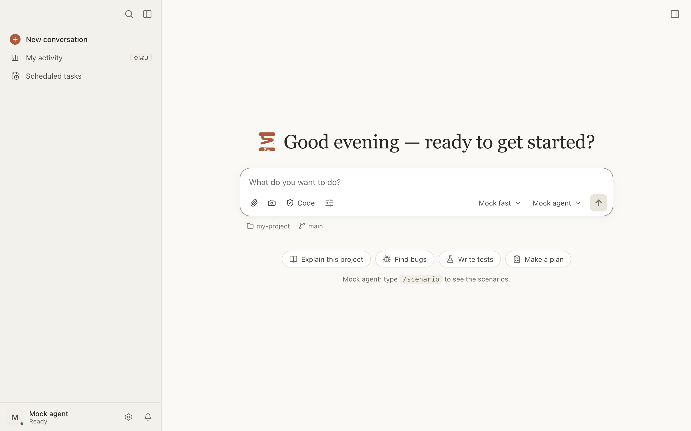

# Getting started

From installation to your first conversation with an agent.

Here you can:

- [install Bobine](#installer);
- [install an agent](#agent);
- [choose the project folder](#dossier);
- [send a first message](#premier-message);
- [connect IBM Bob](#ibm-bob) or [OpenCode](#opencode) the first time;
- [open Bobine from a terminal](#commande-bobine);
- [write to the agent from any app](#fenetre-rapide).

<a id="installer"></a>

## Install Bobine

Bobine is released for macOS (Apple Silicon), as a `.dmg`, on the releases page of the GitHub
repository.

1. Open the `.dmg`.
2. Double-click Bobine in its window. It offers to install itself:
   - **For all users of this Mac**: in the Applications folder (requires administrator rights);
   - **Just for me**: in the Applications folder of your home folder, without administrator
     rights.
3. Click **Install**. Bobine copies itself, restarts from its new location and ejects the disk
   image.

You can also drag Bobine onto Applications, like any app. **Later** asks again at the next launch;
**Don’t ask again** silences it.

**macOS won’t open the `.dmg`?** Bobine isn’t signed by Apple yet: a `.dmg` downloaded by a
browser is quarantined. Remove the attribute before opening it:

```bash
xattr -d com.apple.quarantine ~/Downloads/Bobine-*.dmg
```

Bobine doesn’t update itself: to hear about a new version, watch the repository’s “Releases” on
GitHub. What’s new in each version is in Settings › What’s new.

To install it from source, behind a proxy or offline: see
[docs/installation.md](../../installation.md).

<a id="agent"></a>

## Install an agent

Bobine doesn’t include an agent: it drives the one you installed on the Mac.

- **IBM Bob**: install Bob Shell (the `bob` command).
- **OpenCode**: install OpenCode (the `opencode` command). It gives access to free models.

Bobine starts the agent itself: nothing to start by hand. It only offers installed agents. If you
just installed one and Bobine doesn’t see it: Settings › Diagnostics › **Reload PATH**.

What each agent can do: see [Agents](agents.md).

<a id="dossier"></a>

## Choose the project folder

The first time, Bobine asks for the project folder first: **Choose your project folder**, then
**Choose a folder…**. No agent starts before you choose. The agent will read and change files
there.

To change folders later: click the folder below the message box (**Working folder** menu), then
**Choose a folder…**. The same menu offers **Show in Finder**, **Copy path**, **Open a terminal
here** and [New conversation in a worktree](worktrees.md#nouveau-worktree).

<a id="premier-message"></a>

## Send a first message

1. Check the agent, to the right of the message bar (a click opens the list of installed agents).
2. Write your request in the message box (“What do you want to do?”), or start from a suggestion
   on the home screen: **Explain this project**, **Find bugs**, **Write tests**, **Make a plan**.
   A suggestion fills in the message box without sending it.
3. Press ↩ to send (⇧↩ for a new line).

The agent responds live. Its tools (reads, edits, commands) appear as cards in the conversation;
when it wants to change a file or run a command, it may ask for your approval. See
[Conversations and permissions](conversations.md).



**Choose the default agent** for new conversations: Settings › Conversations › New conversation ›
Agent.

<a id="ibm-bob"></a>

## Connect IBM Bob

On the first message, Bob may ask, in this order:

1. **Folder not trusted**: click **Trust this folder**. Bob remembers it.
2. **Sign-in required**: click the sign-in button offered by Bob (“Log in with SSO”): sign-in
   finishes in your browser. Or **Use an API key**: paste a personal key, then **Sign in**. It is
   encrypted in the macOS Keychain, and can be changed in Settings › Agents › IBM Bob.
3. **License**: depending on the version of Bob, a form appears in the conversation, or **Read the
   license** opens it in Bobine’s terminal. Accept it yourself (`bob --accept-license` in a
   terminal), then **Try again**. Bobine never accepts it for you.

While a step is waiting, the conversation is marked **Action required** in the sidebar.

<a id="opencode"></a>

## Connect OpenCode

OpenCode signs in to its model providers in a terminal. If Bobine asks, click **Sign in in the
terminal** (which runs `opencode auth login`), finish signing in, then **Try again**.

To add an OpenAI-compatible provider (your company’s models): see
[Agents](agents.md#fournisseurs).

<a id="commande-bobine"></a>

## Open Bobine from a terminal

1. Settings › General › **bobine command** › **Install the bobine command**.
2. In a terminal:

```bash
bobine .
```

opens a new conversation in the current folder, and

```bash
bobine . "Fix the failing tests"
```

also writes this message in the message box. It is never sent on its own: read it over, then ↩.

Bobine tells you where it installs the command, and whether that folder is missing from your
`PATH`. If you move the app, reinstall the command.

<a id="fenetre-rapide"></a>

## Write to the agent from any app

⌥⌘B opens **Quick Entry** on top of all apps: write your request (a screenshot can go with it),
then ↩. It goes to a new conversation, with the agent and folder for new conversations, and
Bobine’s window opens on it. Esc closes Quick Entry; the text is kept.

To change the shortcut: Settings › General › **Quick Entry**.
