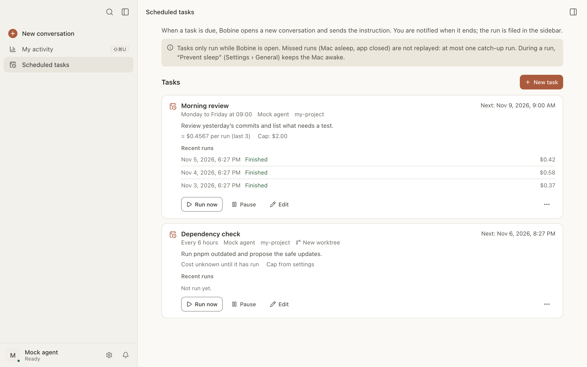

# Scheduled tasks

A scheduled task sends an instruction to an agent at a set time: a review every morning, a cleanup
every four hours, a check just once tomorrow. When it’s due, Bobine opens a new conversation (in a
new worktree if needed) and sends the instruction there.

Here you can:

- [create a task](#creer);
- [choose its frequency](#frequence);
- [cap its cost](#plafond);
- [follow its runs](#executions);
- [pause, edit or delete it](#gerer);
- learn [what happens when Bobine is closed](#bobine-fermee).

## Create a task

To create a task:

1. In the sidebar, click **Scheduled tasks** (under “My activity”).
2. Click **New task**.
3. Write the **Instruction**: what the agent should do on each run.
4. Give it a **Name** if you like. Without a name, it takes the first line of the instruction.
5. **Folder**: click **Choose…** and pick the project folder.
6. **Agent**: by default, the one for new conversations.
7. Choose the **Frequency** and the time (see [below](#frequence)).
8. Click **Save**.

You don’t choose the model or the mode here: the run is an ordinary conversation, with the agent’s
usual settings.

**In a worktree.** Check **Run each time in a new worktree** to keep the changes on a separate
branch. The folder must then be a git repository; otherwise the run fails (“Could not start”). See
[Worktrees](worktrees.md).

## Choose the frequency

| Frequency | What you set |
|---|---|
| Every day | the time (09:00 by default) |
| Weekdays | the time; the task runs Monday to Friday |
| Every N hours | 1 to 24 hours (4 by default), counted from when you save |
| Once | the date and time (a past date is refused) |

The time is the Mac’s.

## Cap the cost

Under **Cap per run**, enter an **Amount** (in the agent’s currency: bobcoins for IBM Bob, dollars
for OpenCode) or a number of **Tokens** (for an agent that doesn’t report its cost). At the cap, the
turn stops and the conversation waits for your approval. Left empty, the cap from
Settings › Conversations applies.

A task that runs several times a day without a cap is flagged in the form: set a cap to bound the
spending.

## Follow the runs

Each task has its card on the **Scheduled tasks** page:

- its frequency, its agent, its folder, and **New worktree** where relevant;
- the next run (“Next: …”), or **Paused**;
- its average cost per run, and per day when it runs several times a day;
- **Recent runs**: the last five, with their state and cost. **Open** opens the run’s
  conversation.

The possible states: **Running**, **Finished**, **Failed**, **Stopped at the cap**,
**Could not start** (hover for the reason), **Skipped: the previous run was still going**,
**Missed**, **Interrupted**.

In the sidebar, a run’s conversation has a small clock. You are notified when it ends, as for any
conversation.

**Permissions.** A scheduled run grants nothing more than an ordinary conversation: a permission
request waits for your answer and notifies you. The run stays “Running” until you answer.

## Run a task right away

Click **Run now** on its card. This also works for a paused task; the run is marked “manual”. The
button is greyed out while a run is going.

## Pause, edit, delete

- **Pause** stops the scheduled runs; **Resume** starts again from now, without catching up on what
  was skipped.
- **Edit** reopens the form. The next run is recalculated from now.
- **…** › **Delete** removes the task and its run history, after confirmation. Conversations
  already started stay in the sidebar.

## When Bobine is closed or the Mac is asleep

Tasks only run while Bobine is open. Missed runs (Mac asleep, app closed) are not replayed one by
one:

- with **Catch up a missed run (a single run)** checked (the default), a single run starts when
  Bobine is back, marked “catch-up”;
- unchecked, a **Missed** row is recorded, and nothing starts.

A run never starts while the previous one is still going: it is recorded as “Skipped”.

To keep the Mac awake during a run: Settings › General › **Prevent sleep**.

## A task in a prepared worktree

If the repository has a setup command (`.bobine/worktree.json`) you haven’t approved yet, the run
doesn’t wait for it: it starts without the setup, and the history notes it (“setup not
approved”). A command already approved runs as usual. See
[Prepare a worktree](worktrees.md#preparation).
