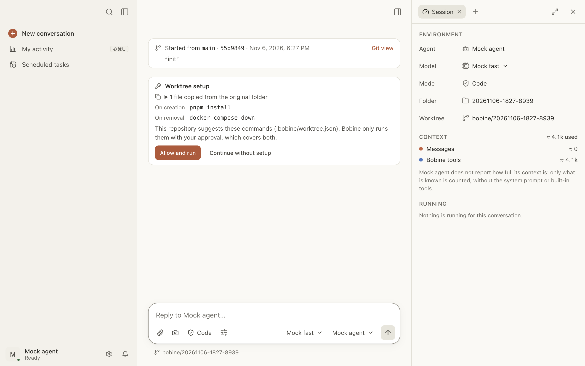

# Worktrees

A git worktree is a second working folder for the same repository, on its own branch. A
conversation in a worktree works on its own: the agent changes whatever it wants there without
touching your folder, and you can run several in parallel. When the work is ready, Bobine brings it
back into `main` without a terminal.

Here, you can:

- [open a conversation in a worktree](#nouveau-worktree);
- [set up each new worktree](#preparation): copy `.env`, run `pnpm install`;
- [commit](#committer), [open a PR](#pr), [merge into `main`](#fusionner);
- [clean up](#nettoyer) the worktree once merged;
- find [orphan worktrees](#orphelins).

<a id="nouveau-worktree"></a>

## Open a conversation in a worktree

1. Below the message box, click the folder (**Working folder** menu).
2. Choose **New conversation in a worktree**.

Bobine opens a new conversation, with the same agent and the same folder, in a fresh worktree:

- the branch is named `bobine/<date>-<time>-<code>`;
- the folder is `.worktrees/<name>` at the root of the repository (Bobine adds it to
  `.git/info/exclude`, without touching your tracked files);
- the worktree starts from the current commit of the original folder.

The menu item only appears in a git repository with at least one commit.

**The starting card.** At the top of the conversation, a card shows which branch and commit the
worktree starts from. If the original folder has uncommitted changes, it warns you: they are not in
the worktree. **Git view** opens the Changes tab.

In the conversation, the folder below the message box shows the worktree’s branch.

**Side by side.** To follow two conversations at once: in a conversation’s menu in the sidebar,
**Open side by side**.

<a id="preparation"></a>

## Set up each new worktree

A fresh worktree only contains the files tracked by git: no `.env`, no `node_modules`. Two files at
the root of the repository make it ready to use. They apply to every conversation in a worktree,
including [child conversations](conversations-filles.md) and
[scheduled tasks](taches-planifiees.md).

<a id="worktreeinclude"></a>

### Copy ignored files: `.worktreeinclude`

List in `.worktreeinclude`, using `.gitignore` syntax, the git-ignored files to copy over from the
original folder:

```gitignore
.env
.env.local
config/secrets.json
```

Only files that git actually ignores are copied. Never symbolic links, anything outside the
repository, or a file already in the worktree. At most 5,000 files and 500 MB.

Keep this file for small configuration files: for dependencies, a pattern like `node_modules/`
quickly hits the limit. Install them with the `setup` command instead.

<a id="worktree-json"></a>

### Run commands: `.bobine/worktree.json`

```json
{
  "setup": "pnpm install",
  "archive": "docker compose down"
}
```

- `setup` runs when the worktree is created, after the copy, at the root of the worktree. It has
  15 minutes at most.
- `archive` runs in the worktree just before Bobine deletes it (“Clean up”, or deleting the
  conversation along with its worktree). It has 2 minutes at most; a failure doesn’t prevent the
  deletion.

Both are optional. Each is **one** shell command, written as a single string (to chain several:
`pnpm install && pnpm build`). A list, any other key or invalid JSON is ignored without a message.

The commands receive these variables: `BOBINE_WORKTREE_SOURCE` (the original folder),
`BOBINE_WORKTREE_PATH` (the worktree) and `BOBINE_WORKTREE_BRANCH` (its branch).

Bobine reads these two files in the original folder, uncommitted changes included.

<a id="accord"></a>

### Give your approval

The commands come from the repository: Bobine never runs them without your approval. The
**Worktree setup** card in the conversation shows them, **On creation** and **On removal**:

- **Allow and run**: the `setup` command runs, with its status and output in the card. The
  approval applies to this repository and to these exact commands.
- **Continue without setup**: nothing is run in this worktree; the agent knows the setup didn’t
  happen.

Bobine asks again if a command changes, even between the card appearing and your click: in that
case, nothing is run and the card shows the new commands.



A message sent before the approval waits: the card says so, and it is sent when the command ends.
While the command runs:

- **Stop** stops the command; queued messages are sent;
- **Continue without waiting** (when a message is waiting) lets the command finish and sends the
  message right away.

If the command fails, the conversation goes on and the agent knows; the output is expanded in the
card. The list of copied files can be expanded too.

**Without you.** A child conversation or a scheduled task doesn’t wait for approval: it goes ahead
without the setup, and says so. A command that is already allowed runs as usual.

**Withdraw an approval**: Settings › Privacy › **Allowed without asking**, line
“Worktree setup · …”, **Revoke**. See [Settings](reglages.md#autorisations).

<a id="vue-git"></a>

## A worktree’s Git view

Open the **Changes** tab of the side panel (⇧⌘D), then the **Git** view. At the top: the branch,
its starting point, and its state (“2 commits on the branch”, “3 files to commit”, “Merged into
main.”…). Below: the changed files, checked, and the actions.

<a id="committer"></a>

## Commit

1. Uncheck the files to leave out.
2. Click **Commit (N)**.
3. Review the suggested **Commit message** (based on the conversation title and the files), edit it
   if needed, then **Commit**.

**Undo** cancels the commit as long as it’s the latest one and isn’t in the base branch; its
changes are back to be committed.

“Commit” is also available outside worktrees, in the Git view of an ordinary conversation.

<a id="pr"></a>

## Open a pull request

1. Click **Open a PR**.
2. Review the suggested **Title** and **Description**.
3. Click **Push and open the PR**.

Bobine pushes the branch, then creates the PR with the `gh` command. You need
[`gh` installed and signed in to GitHub](depannage.md#gh) and a remote repository; otherwise, the
reason appears below the buttons. After that, the Git view follows the PR and its CI: see
[PR and CI tracking](suivi-pr-ci.md).

<a id="fusionner"></a>

## Merge into `main`

Click **Merge into main** (or the name of your base branch). The button is greyed out while the
worktree still has uncommitted changes, or when there is nothing to merge.

Bobine first updates the worktree with the base if the base has moved on, then moves the base
forward.

**Conflicts.** If the update runs into conflicts, the view lists them file by file:

- **Let the agent resolve**: the agent removes the conflict markers, then Bobine resumes the merge;
- **Retry**, after resolving them yourself;
- **Abort**: the branch goes back to how it was.

**The main folder has uncommitted changes.** The merge could overwrite them: Bobine refuses to go
ahead and lists the files. Two choices:

- **Commit first**: a message is suggested, then **Commit, then merge**;
- **Set aside**: the changes are put away (`git stash`) during the merge, then restored.

<a id="nettoyer"></a>

## Clean up

Once the branch is merged (or its PR merged on GitHub), **Clean up** archives the conversation,
runs the `archive` command if you allowed it, then deletes the worktree and its branch. Brought
back from the archive, the conversation continues in the main folder.

**Deleting a conversation that has a worktree**: the **Also delete the worktree and the branch**
checkbox is checked by default only when nothing would be lost; otherwise, Bobine says what would
be.

A worktree where nothing was done disappears on its own when Bobine quits.

<a id="orphelins"></a>

## Orphan worktrees

A worktree whose conversation was deleted stays on disk. To find them: Settings › Data
› **Orphan worktrees**. **Clean up** deletes the worktree and its branch, after confirmation
(Bobine says whether there are uncommitted files or unmerged commits left). The `archive` command
isn’t run in this case.
