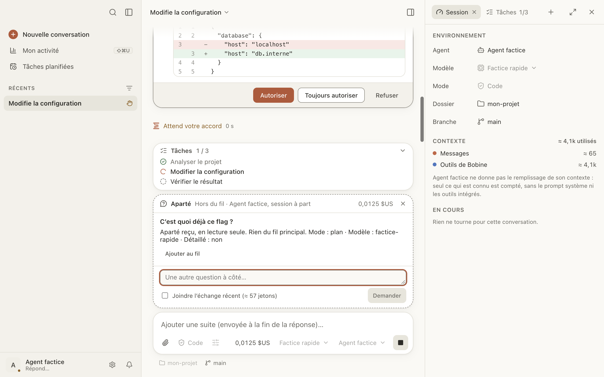

# Aparté

Un aparté, c'est une question posée à côté de la conversation : « c'est quoi déjà ce flag ? »,
« que fait cette fonction ? ». Le même agent y répond dans une session à part, en lecture seule.
Rien n'est ajouté à la conversation, ni à ce que l'agent en retient. Ça marche même pendant que
l'agent travaille, et avant le premier message.

Ici, vous pouvez :

- [poser une question en aparté](#poser) ;
- [lui donner le contexte de la conversation](#contexte) ;
- [recopier la réponse dans la conversation](#ajouter-au-fil) ;
- savoir [ce que coûte un aparté](#cout).

## Poser une question en aparté

Au choix :

- tapez `/btw` suivi de votre question dans la zone de saisie, puis ↩ ;
- ⇧⌘A, ou le menu Conversation › **Aparté…**, puis écrivez la question et cliquez sur
  **Demander**.

La carte **Aparté** s'ouvre au-dessus de la zone de saisie, marquée « Hors du fil ». La réponse y
arrive. Vous pouvez poser d'autres questions dans la même carte : l'aparté garde sa session.

Pour fermer l'aparté : ✕ sur la carte, ou Échap. Sa session est alors supprimée chez l'agent.

**En lecture seule.** L'agent de l'aparté ne peut rien modifier : toute demande d'autorisation est
refusée d'office, et la carte le dit (« L'agent a voulu modifier quelque chose : refusé… »). Avec
un agent qui ne demande jamais d'autorisation, seule la consigne de lecture seule le retient.

## Donner le contexte de la conversation

Par défaut, l'aparté ne reçoit rien de la conversation : il voit le dossier, pas l'échange. Pour
qu'il sache de quoi vous parlez, cochez **Joindre l'échange récent** : la fin de la conversation
(environ 2 000 jetons au plus, le nombre estimé est affiché) part avec la question.

Tant que la case est cochée, cet extrait est joint à **chaque** question de l'aparté.

## Recopier la réponse dans la conversation

Sous une réponse, **Ajouter au fil** recopie la question et la réponse dans la zone de saisie, en
citation. Rien n'est envoyé : relisez, complétez, puis envoyez si vous le voulez. L'aparté se ferme.

## Ce que coûte un aparté

Le coût de l'aparté s'affiche sur sa carte et est compté dans celui de la conversation (et dans
son plafond). Joindre l'échange récent coûte plus cher, à chaque question.

Un agent qui ne donne que des jetons, sans coût, n'ajoute rien au coût de la conversation.
