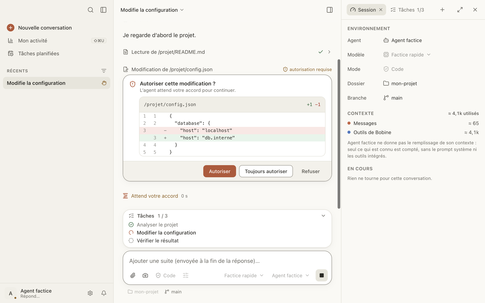

# Conversations et autorisations

Tout se passe dans la conversation : vous écrivez, l'agent répond et travaille, Bobine vous
demande votre accord quand il le faut.

Ici, vous pouvez :

- [répondre à une demande d'autorisation](#autorisations) ;
- [retrouver et retirer un accord « toujours »](#accords-retenus) ;
- [répondre aux questions de l'agent](#questions) ;
- [arrêter l'agent](#arreter) ou [lui écrire pendant qu'il travaille](#file-d-attente) ;
- [joindre des fichiers et des images](#pieces-jointes), [mentionner un fichier](#mentions),
  [lancer une commande « / »](#commandes) ;
- [relire et annoter un plan](#plan) ;
- [repartir d'un message](#repartir) ;
- [retrouver une conversation](#historique) et [chercher dedans](#rechercher) ;
- [suivre ce que coûte une conversation](#cout).

## Répondre à une demande d'autorisation

Quand l'agent veut modifier un fichier, en supprimer un ou lancer une commande, il peut vous
demander votre accord. Une carte s'affiche dans le fil (« Autoriser cette modification ? »,
« Autoriser cette commande ? »…), et la conversation est marquée **Attend votre réponse** dans la
barre latérale.

Les boutons sont ceux de l'agent : avec IBM Bob, « Allow once », « Always allow » et « Reject ».
Le premier est mis en avant.

**Ce qui est demandé dépend de l'agent.** IBM Bob demande avant d'écrire et avant de lancer une
commande. OpenCode, par défaut, ne demande rien. Voir [Agents](agents.md#autorisations).

**Les outils de Bobine.** Quand l'agent se sert des outils de Bobine (ouvrir un site dans le
navigateur intégré, lancer une commande dans le terminal, compiler, lancer l'app), c'est Bobine
qui demande, et vous voyez toujours la commande exacte :

- pour un site : **Autoriser** (pour cette conversation), **Toujours autoriser** (retenu sur ce
  Mac) ou **Refuser** ;
- pour une commande ou une compilation : **Lancer** ou **Compiler**, **Toujours dans ce projet**
  (sans redemander dans ce dossier) ou **Refuser**.

Un outil refusé est marqué « refusé » dans le fil.

## Retrouver et retirer un accord « toujours »

Réglages › Confidentialité › **Autorisé sans demander** liste ce que vous avez autorisé une fois
pour toutes : outils, sites, commandes par dossier, préparation des worktrees. **Révoquer** le
retire ; l'agent redemandera.

Bobine ne retient jamais d'une conversation à l'autre un « toujours » donné à une modification, une
suppression, un déplacement ou une commande de l'agent.

## Répondre aux questions de l'agent

L'agent peut vous poser une question à choix : cliquez sur une réponse, ou tapez son numéro (1 à
9), ou écrivez la vôtre dans **Autre…**. Plusieurs questions se suivent dans des onglets :
**Suivant**, **Passer**, puis **Envoyer**.

Il peut aussi demander de remplir un formulaire (**Envoyer** ou **Refuser**), ou d'ouvrir une page
dans votre navigateur.

## Arrêter l'agent

Pendant qu'il travaille, le bouton d'envoi devient un carré : cliquez dessus, ou Échap, ou ⌘.
(menu Conversation › Arrêter la réponse). Le fil marque « Réponse interrompue », et l'outil en
cours « interrompu ».

Si une commande ne rend plus rien depuis quelques minutes, sa carte le signale (« Aucune sortie
depuis 3 min ») avec **Interrompre**. Le délai se règle dans Réglages › Conversations.

## Écrire pendant que l'agent travaille

Écrivez dans la zone de saisie (« Ajouter une suite… ») et ↩ : le message attend au-dessus de la
zone de saisie et part à la fin de la réponse. Plusieurs messages en attente partent ensemble, en
un seul.

Sur un message en attente : **Envoyer maintenant** (interrompt l'agent et l'envoie), **Modifier**
(ou ↑ dans une zone de saisie vide), **Retirer**.

Pour une question qui ne doit pas entrer dans la conversation : un [aparté](aparte.md).

## Joindre des fichiers et des images

Glissez des fichiers sur la conversation, collez une image, ou cliquez sur le trombone : **Joindre
des fichiers…** ou **Capturer une zone de l'écran**. Au plus 10 pièces jointes par message, et
5 Mo par image. Une image jointe peut être annotée avant l'envoi.

Un long texte collé (plus de 40 lignes ou de 4 000 caractères) devient une pièce jointe « Texte
collé » ; **Remettre dans la saisie** le replace dans le message.

Avec IBM Bob, un fichier exclu (`.gitignore`, `.bobignore`, `.env`) demande confirmation : Bob ne
l'ouvrirait pas lui-même.

## Mentionner un fichier avec @

Tapez `@` et le début d'un nom : Bobine propose les fichiers du dossier. ↩ ou ⇥ joint le fichier
au message.

Deux mentions spéciales :

- `@git-changes` : l'état et le diff du dossier depuis le dernier commit ;
- `@terminal` : les dernières lignes du terminal de la conversation.

## Lancer une commande « / »

En début de message, tapez `/` : la liste des commandes s'ouvre. Celles de Bobine marchent avec
tous les agents :

| Commande | Ce qu'elle fait |
|---|---|
| `/clear` | Nouvelle conversation, même agent et même dossier |
| `/compact` | Résumer la conversation pour libérer du contexte |
| `/context` | Contexte utilisé et consommation |
| `/cost` | Coût de la conversation |
| `/model [nom]` | Voir ou changer le modèle |
| `/mode [nom]` | Voir ou changer le mode (agent, plan…) |
| `/init` | Créer ou compléter `AGENTS.md` pour ce projet |
| `/review` | Revue des modifications en cours, par l'agent de la conversation |
| `/split [message]` | Découper le message en [conversations filles](conversations-filles.md#taches-proposees) |
| `/btw [question]` | [Aparté](aparte.md) : une question à côté, répondue hors du fil |
| `/help` | Liste des commandes |

La liste montre aussi les commandes de l'agent et vos commandes personnelles ou du projet
(Réglages › Commandes).

## Relire et annoter un plan

En [mode Plan](modes-et-modeles.md#mode-plan), l'agent propose un plan : il s'affiche en document
dans le fil (« Plan proposé »).

1. Sélectionnez un passage, puis **Commenter**, écrivez votre remarque et **Ajouter la remarque**.
2. Puis :
   - **Envoyer mes remarques** : l'agent reste en mode Plan et renvoie le plan complet, corrigé ;
     **Voir ce qui a changé** compare les versions ;
   - **Exécuter le plan** : l'agent quitte le mode Plan et se met au travail.

## Modifier un message, repartir d'un message

Au survol d'un de vos messages, **Modifier** permet de le réécrire. **Envoyer** ouvre alors une
nouvelle conversation (une branche) qui reprend l'échange jusqu'à ce message ; l'originale reste
dans l'historique, telle quelle. **Réessayer**, sur votre dernier message, fait de même sans le
changer.

Si des fichiers ont changé depuis ce message, Bobine propose de **remettre les fichiers dans leur
état d'alors**. Les effets des commandes lancées depuis restent.

## Retrouver une conversation

La barre latérale range les conversations :

- **À traiter** : celles qui vous attendent (autorisation, question, erreur, réponse à lire) ;
- **Épinglées** ;
- **Récents**, ou **Dossiers** pour les grouper par projet (au choix dans le menu **Afficher**) ;
- **Archivées**, repliées en dernier.

Le menu **…** d'une conversation propose : Épingler, Ouvrir à côté, Renommer, Lancer en
parallèle…, Exporter en Markdown… ou en JSON…, Archiver, Supprimer. En supprimant, vous pouvez
aussi supprimer la session chez l'agent, s'il le permet.

⌥⌘↑ et ⌥⌘↓ passent à la conversation précédente ou suivante.

**Reprendre une session commencée ailleurs** (dans `bob`, `opencode`…) : ⇧⌘O, ou **Reprendre une
session…** dans la barre latérale.

En rouvrant une conversation laissée depuis plus d'un jour, une carte **Où en était-on ?**
rappelle la dernière demande, ce qui est fait et en cours, et les fichiers non commités. Bobine la
construit seule : rien n'est envoyé à l'agent.

## Chercher une conversation, chercher dans une conversation

- ⌘K (la loupe en haut de la barre latérale) cherche parmi toutes les conversations : titre,
  dossier, agent et contenu, avec un extrait. Une conversation trouvée par son contenu s'ouvre sur
  les mots cherchés.
- ⌘F cherche dans la conversation ouverte, sans tenir compte de la casse ni des accents ; ⌘G et
  ⇧⌘G passent d'un résultat à l'autre.

## Suivre ce que coûte une conversation

La puce de consommation, sous la zone de saisie, montre le remplissage du contexte (ou le coût,
pour un agent qui ne donne pas son contexte). Un clic ouvre le détail : contexte, jetons, coût,
moyenne et une ligne par échange, et **Toute mon activité…** (⇧⌘U), qui réunit toutes les
conversations.

Le coût est en Bobcoins pour IBM Bob, en dollars pour OpenCode (0 avec un modèle gratuit).

Quand le contexte est presque plein, **Compacter** apparaît à côté de la puce : l'agent résume la
conversation pour libérer de la place.

**Plafond de coût.** Réglages › Conversations › Pendant la réponse › **Plafond par conversation**
(désactivé par défaut) borne le coût des nouvelles conversations. Une fois dépassé, Bobine arrête
la réponse à la fin de l'outil en cours et demande **Continuer** ou **Arrêter**. Le plafond d'une
conversation se change dans le détail de sa consommation.
