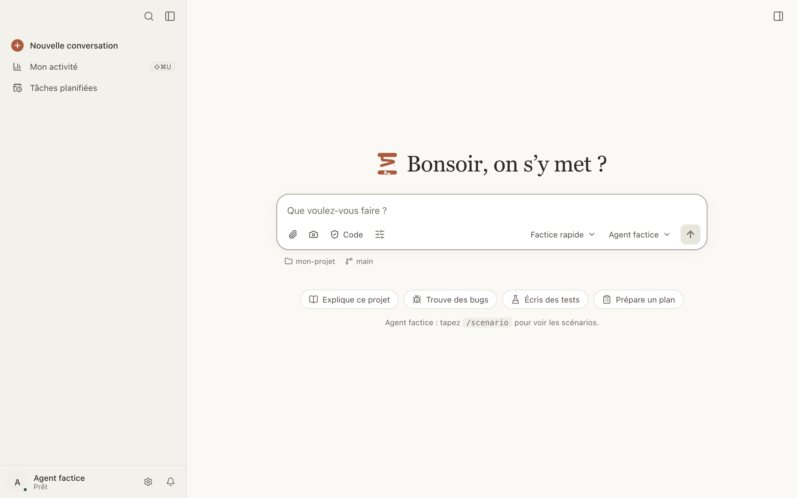

# Premiers pas

De l'installation à votre première conversation avec un agent.

Ici, vous pouvez :

- [installer Bobine](#installer) ;
- [installer un agent](#agent) ;
- [choisir le dossier du projet](#dossier) ;
- [envoyer un premier message](#premier-message) ;
- [connecter IBM Bob](#ibm-bob) ou [OpenCode](#opencode) au premier lancement ;
- [ouvrir Bobine depuis un terminal](#commande-bobine) ;
- [écrire à l'agent depuis n'importe quelle app](#fenetre-rapide).

<a id="installer"></a>

## Installer Bobine

Bobine est publiée pour macOS (Apple Silicon), en `.dmg`, sur la page des versions du dépôt GitHub.

1. Ouvrez le `.dmg`.
2. Double-cliquez sur Bobine dans sa fenêtre. Elle propose de s'installer elle-même :
   - **Pour tous les utilisateurs de ce Mac** : dans le dossier Applications (il faut les droits
     d'administrateur) ;
   - **Pour moi seulement** : dans le dossier Applications de votre dossier personnel, sans droits
     d'administrateur.
3. Cliquez sur **Installer**. Bobine se copie, se relance depuis sa nouvelle place et éjecte le
   disque image.

Vous pouvez aussi glisser Bobine sur Applications, comme toute app. **Plus tard** repose la
question au lancement suivant ; **Ne plus proposer** la fait taire.

**macOS refuse d'ouvrir le `.dmg` ?** Bobine n'est pas encore signée par Apple : un `.dmg`
téléchargé par un navigateur est mis en quarantaine. Retirez l'attribut avant de l'ouvrir :

```bash
xattr -d com.apple.quarantine ~/Downloads/Bobine-*.dmg
```

Bobine ne se met pas à jour toute seule : pour être prévenu d'une nouvelle version, suivez les
« Releases » du dépôt sur GitHub. Les nouveautés de chaque version sont dans Réglages ›
Nouveautés.

Pour l'installer depuis les sources, derrière un proxy ou sans réseau : voir
[docs/installation.md](../../installation.md).

<a id="agent"></a>

## Installer un agent

Bobine ne contient pas d'agent : elle pilote celui que vous avez installé sur le Mac.

- **IBM Bob** : installez Bob Shell (la commande `bob`).
- **OpenCode** : installez OpenCode (la commande `opencode`). Il donne accès à des modèles
  gratuits.

Bobine lance l'agent elle-même : rien à lancer à la main. Elle ne propose que les agents installés.
Si vous venez d'en installer un et qu'elle ne le voit pas : Réglages › Diagnostic › **Relire le
PATH**.

Ce que chaque agent permet : voir [Agents](agents.md).

<a id="dossier"></a>

## Choisir le dossier du projet

Au premier lancement, Bobine demande d'abord le dossier du projet : **Choisissez le dossier de
votre projet**, puis **Choisir un dossier…**. Aucun agent ne démarre avant ce choix. L'agent y
lira et modifiera des fichiers.

Pour changer de dossier ensuite : cliquez sur le dossier sous la zone de saisie (menu **Dossier de
travail**), puis **Choisir un dossier…**. Le même menu propose **Afficher dans le Finder**,
**Copier le chemin**, **Ouvrir un terminal ici** et
[Nouvelle conversation dans un worktree](worktrees.md#nouveau-worktree).

<a id="premier-message"></a>

## Envoyer un premier message

1. Vérifiez l'agent, à droite de la barre de saisie (un clic ouvre la liste des agents
   installés).
2. Écrivez votre demande dans la zone de saisie (« Que voulez-vous faire ? »), ou partez d'une
   suggestion de l'accueil : **Explique ce projet**, **Trouve des bugs**, **Écris des tests**,
   **Prépare un plan**. Une suggestion remplit la zone de saisie sans l'envoyer.
3. Appuyez sur ↩ pour envoyer (⇧↩ pour aller à la ligne).

L'agent répond en direct. Ses outils (lectures, modifications, commandes) s'affichent en cartes
dans le fil ; quand il veut modifier un fichier ou lancer une commande, il peut vous demander votre
accord. Voir [Conversations et autorisations](conversations.md).



**Choisir l'agent par défaut** des nouvelles conversations : Réglages › Conversations › Nouvelle
conversation › Agent.

<a id="ibm-bob"></a>

## Connecter IBM Bob

Au premier message, Bob peut demander, dans cet ordre :

1. **Dossier non approuvé** : cliquez sur **Faire confiance à ce dossier**. Bob s'en souvient.
2. **Connexion requise** : cliquez sur le bouton de connexion proposé par Bob (« Log in with
   SSO ») : la connexion se termine dans votre navigateur. Ou **Utiliser une clé d'API** : collez
   une clé personnelle, puis **Se connecter**. Elle est chiffrée dans le trousseau macOS, et se
   change dans Réglages › Agents › IBM Bob.
3. **Licence** : selon la version de Bob, un formulaire s'affiche dans la conversation, ou
   **Lire la licence** l'ouvre dans le terminal de Bobine. Acceptez-la vous-même
   (`bob --accept-license` dans un terminal), puis **Réessayer**. Bobine ne l'accepte jamais à
   votre place.

Tant qu'une étape attend, la conversation est marquée **Action requise** dans la barre latérale.

<a id="opencode"></a>

## Connecter OpenCode

OpenCode se connecte à ses fournisseurs de modèles dans un terminal. Si Bobine le demande, cliquez
sur **Se connecter dans le terminal** (qui lance `opencode auth login`), terminez la connexion,
puis **Réessayer**.

Pour déclarer un fournisseur compatible OpenAI (modèles de votre entreprise) : voir
[Agents](agents.md#fournisseurs).

<a id="commande-bobine"></a>

## Ouvrir Bobine depuis un terminal

1. Réglages › Général › **Commande bobine** › **Installer la commande bobine**.
2. Dans un terminal :

```bash
bobine .
```

ouvre une nouvelle conversation dans le dossier courant, et

```bash
bobine . "Corrige les tests qui échouent"
```

écrit aussi ce message dans la zone de saisie. Il n'est jamais envoyé tout seul : relisez-le,
puis ↩.

Bobine dit où elle installe la commande, et si ce dossier manque à votre `PATH`. Si vous déplacez
l'app, réinstallez la commande.

<a id="fenetre-rapide"></a>

## Écrire à l'agent depuis n'importe quelle app

⌥⌘B ouvre la **fenêtre rapide** par-dessus toutes les apps : écrivez votre demande (une capture
d'écran peut l'accompagner), puis ↩. Elle part dans une nouvelle conversation, avec l'agent et le
dossier des nouvelles conversations, et la fenêtre de Bobine s'ouvre dessus. Échap ferme la
fenêtre rapide ; le texte est gardé.

Pour changer le raccourci : Réglages › Général › **Fenêtre rapide**.
