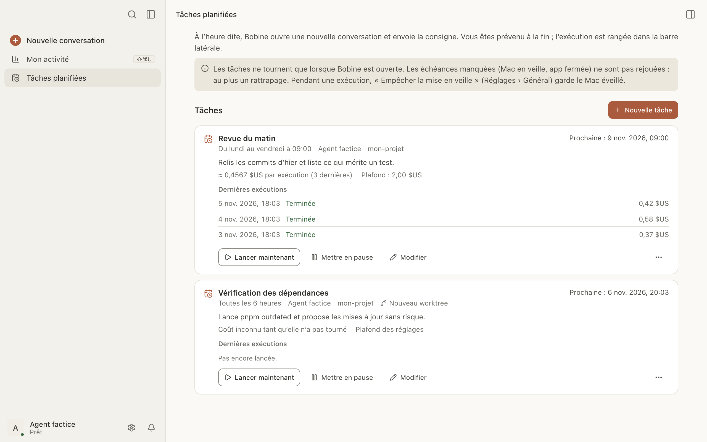

# Tâches planifiées

Une tâche planifiée envoie une consigne à un agent à heure fixe : une revue chaque matin, un
nettoyage toutes les quatre heures, une vérification une seule fois demain. À l'heure dite, Bobine
ouvre une nouvelle conversation (au besoin dans un nouveau worktree) et y envoie la consigne.

Ici, vous pouvez :

- [créer une tâche](#creer) ;
- [choisir sa fréquence](#frequence) ;
- [borner son coût](#plafond) ;
- [suivre ses exécutions](#executions) ;
- [la mettre en pause, la modifier, la supprimer](#gerer) ;
- savoir [ce qui se passe quand Bobine est fermée](#bobine-fermee).

## Créer une tâche

Pour créer une tâche :

1. Dans la barre latérale, cliquez sur **Tâches planifiées** (sous « Mon activité »).
2. Cliquez sur **Nouvelle tâche**.
3. Écrivez la **Consigne** : ce que l'agent doit faire à chaque exécution.
4. Donnez-lui un **Nom**, si vous voulez. Sans nom, elle prend la première ligne de la consigne.
5. **Dossier** : cliquez sur **Choisir…** et prenez le dossier du projet.
6. **Agent** : par défaut, celui des nouvelles conversations.
7. Choisissez la **Fréquence** et l'heure (voir [plus bas](#frequence)).
8. Cliquez sur **Enregistrer**.

Le modèle et le mode ne se choisissent pas ici : l'exécution est une conversation ordinaire, avec
les réglages habituels de l'agent.

**Dans un worktree.** Cochez **Chaque exécution dans un nouveau worktree** pour que les
modifications restent sur une branche à part. Le dossier doit alors être un dépôt git ; sinon,
l'exécution échoue (« Lancement impossible »). Voir [Worktrees](worktrees.md).

## Choisir la fréquence

| Fréquence | Ce qu'on règle |
|---|---|
| Chaque jour | l'heure (09:00 par défaut) |
| Jours de semaine | l'heure ; la tâche tourne du lundi au vendredi |
| Toutes les N heures | de 1 à 24 heures (4 par défaut), compté depuis l'enregistrement |
| Une fois | la date et l'heure (une date passée est refusée) |

L'heure est celle du Mac.

## Borner le coût

Sous **Plafond par exécution**, donnez un **Montant** (dans la devise de l'agent : Bobcoins pour
IBM Bob, dollars pour OpenCode) ou un nombre de **Jetons** (pour un agent qui ne donne pas son
coût). Au plafond, le tour s'arrête et la conversation attend votre accord. Laissé vide, c'est le
plafond de Réglages › Conversations qui s'applique.

Une tâche qui tourne plusieurs fois par jour sans plafond est signalée dans le formulaire : fixez
un plafond pour borner la dépense.

## Suivre les exécutions

Chaque tâche a sa carte sur la page **Tâches planifiées** :

- sa fréquence, son agent, son dossier, et **Nouveau worktree** le cas échéant ;
- la prochaine échéance (« Prochaine : … »), ou **En pause** ;
- son coût moyen par exécution, et par jour quand elle tourne plusieurs fois par jour ;
- **Dernières exécutions** : les cinq dernières, avec leur état et leur coût. **Ouvrir** ouvre la
  conversation de l'exécution.

Les états possibles : **En cours**, **Terminée**, **En erreur**, **Arrêtée au plafond**,
**Lancement impossible** (le survol donne la raison), **Sautée : la précédente tournait encore**,
**Manquée**, **Interrompue**.

Dans la barre latérale, la conversation d'une exécution porte une petite horloge. Vous êtes
prévenu à la fin, comme pour toute conversation.

**Les autorisations.** Une exécution planifiée n'accorde rien de plus qu'une conversation
ordinaire : une demande d'autorisation attend votre réponse et vous prévient. L'exécution reste
« En cours » tant que vous n'avez pas répondu.

## Lancer une tâche tout de suite

Cliquez sur **Lancer maintenant** sur sa carte. Cela marche aussi pour une tâche en pause ;
l'exécution est marquée « à la main ». Le bouton est grisé pendant qu'une exécution tourne.

## Mettre en pause, modifier, supprimer

- **Mettre en pause** arrête les échéances ; **Reprendre** repart de maintenant, sans rattraper
  ce qui a été sauté.
- **Modifier** rouvre le formulaire. L'échéance suivante est recalculée à partir de maintenant.
- **…** › **Supprimer** efface la tâche et l'historique de ses exécutions, après confirmation.
  Les conversations déjà lancées restent dans la barre latérale.

## Quand Bobine est fermée ou le Mac en veille

Les tâches ne tournent que lorsque Bobine est ouverte. Les échéances manquées (Mac en veille, app
fermée) ne sont pas rejouées une par une :

- avec **Rattraper une échéance manquée (une seule exécution)** coché (par défaut), une seule
  exécution part au retour, marquée « rattrapage » ;
- décoché, une ligne **Manquée** est notée, et rien ne part.

Une exécution ne part jamais tant que la précédente tourne : elle est notée « Sautée ».

Pour que le Mac ne s'endorme pas pendant une exécution : Réglages › Général › **Empêcher la mise
en veille**.

## Une tâche dans un worktree préparé

Si le dépôt a une commande de préparation (`.bobine/worktree.json`) que vous n'avez pas encore
autorisée, l'exécution ne l'attend pas : elle part sans la préparation, et l'historique le note
(« préparation non autorisée »). Une commande déjà autorisée est lancée normalement. Voir
[Préparer un worktree](worktrees.md#preparation).
