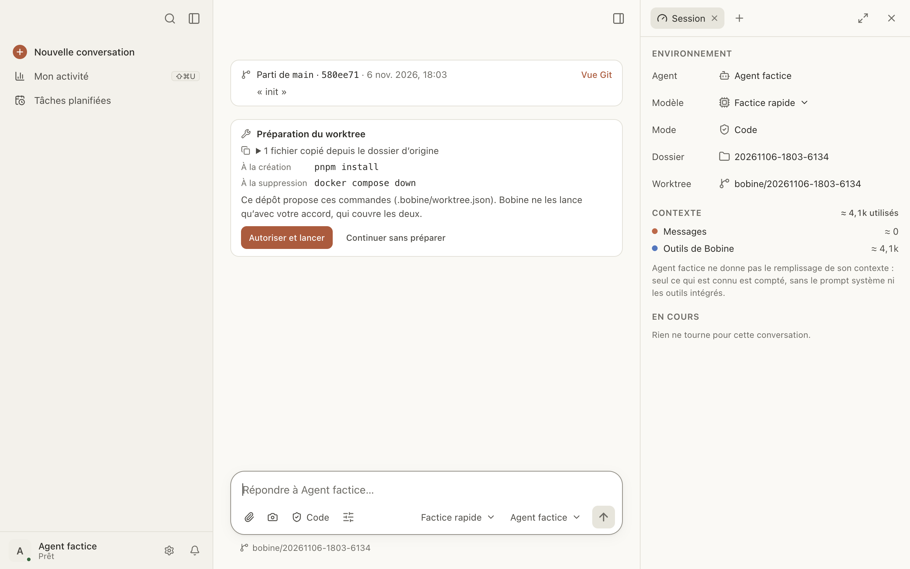

# Worktrees

Un worktree git est un second dossier de travail du même dépôt, sur sa propre branche. Une
conversation dans un worktree travaille à part : l'agent y modifie ce qu'il veut sans toucher à
votre dossier, et vous pouvez en lancer plusieurs en parallèle. Quand le travail est prêt, Bobine
le ramène dans `main` sans passer par un terminal.

Ici, vous pouvez :

- [ouvrir une conversation dans un worktree](#nouveau-worktree) ;
- [préparer chaque nouveau worktree](#preparation) : copier `.env`, lancer `pnpm install` ;
- [committer](#committer), [ouvrir une PR](#pr), [fusionner dans `main`](#fusionner) ;
- [nettoyer](#nettoyer) le worktree une fois fusionné ;
- retrouver les [worktrees orphelins](#orphelins).

<a id="nouveau-worktree"></a>

## Ouvrir une conversation dans un worktree

1. Sous la zone de saisie, cliquez sur le dossier (menu **Dossier de travail**).
2. Choisissez **Nouvelle conversation dans un worktree**.

Bobine ouvre une nouvelle conversation, avec le même agent et le même dossier, dans un worktree
neuf :

- la branche s'appelle `bobine/<date>-<heure>-<code>` ;
- le dossier est `.worktrees/<nom>` à la racine du dépôt (Bobine l'ajoute à `.git/info/exclude`,
  sans toucher à vos fichiers suivis) ;
- le worktree part du commit en cours du dossier d'origine.

L'entrée n'apparaît que dans un dépôt git qui a au moins un commit.

**La carte de départ.** En tête du fil, une carte dit de quelle branche et de quel commit part le
worktree. Si le dossier d'origine a des modifications non commitées, elle prévient : elles ne sont
pas dans le worktree. **Vue Git** ouvre l'onglet Modifications.

Dans la conversation, le dossier sous la zone de saisie montre la branche du worktree.

**Côte à côte.** Pour suivre deux conversations à la fois : dans le menu d'une conversation de la
barre latérale, **Ouvrir à côté**.

<a id="preparation"></a>

## Préparer chaque nouveau worktree

Un worktree neuf ne contient que les fichiers suivis par git : pas de `.env`, pas de
`node_modules`. Deux fichiers à la racine du dépôt le rendent prêt à l'emploi. Ils servent à toute
conversation dans un worktree, y compris les [conversations filles](conversations-filles.md) et
les [tâches planifiées](taches-planifiees.md).

<a id="worktreeinclude"></a>

### Copier des fichiers ignorés : `.worktreeinclude`

Listez dans `.worktreeinclude`, avec la syntaxe de `.gitignore`, les fichiers ignorés par git à
recopier depuis le dossier d'origine :

```gitignore
.env
.env.local
config/secrets.json
```

Seuls les fichiers que git ignore vraiment sont copiés. Jamais les liens symboliques, ni ce qui est
hors du dépôt, ni un fichier déjà présent dans le worktree. Au plus 5 000 fichiers et 500 Mo.

Gardez ce fichier pour les petits fichiers de configuration : pour les dépendances, un motif comme
`node_modules/` atteint vite le plafond. Installez-les plutôt avec la commande `setup`.

<a id="worktree-json"></a>

### Lancer des commandes : `.bobine/worktree.json`

```json
{
  "setup": "pnpm install",
  "archive": "docker compose down"
}
```

- `setup` est lancée à la création du worktree, après la copie, à la racine du worktree. Elle a
  15 minutes au plus.
- `archive` est lancée dans le worktree juste avant que Bobine le supprime (« Nettoyer », ou
  suppression de la conversation avec son worktree). Elle a 2 minutes au plus ; un échec
  n'empêche pas la suppression.

Les deux sont facultatives. Chacune est **une** commande du shell, écrite en une chaîne (pour en
enchaîner plusieurs : `pnpm install && pnpm build`). Une liste, une autre clé ou un JSON invalide
sont ignorés sans message.

Les commandes reçoivent ces variables : `BOBINE_WORKTREE_SOURCE` (le dossier d'origine),
`BOBINE_WORKTREE_PATH` (le worktree) et `BOBINE_WORKTREE_BRANCH` (sa branche).

Bobine lit ces deux fichiers dans le dossier d'origine, modifications non commitées comprises.

<a id="accord"></a>

### Donner son accord

Les commandes viennent du dépôt : Bobine ne les lance jamais sans votre accord. La carte
**Préparation du worktree** du fil les montre, **À la création** et **À la suppression** :

- **Autoriser et lancer** : la commande `setup` tourne, avec son état et sa sortie dans la carte.
  L'accord vaut pour ce dépôt et pour ces commandes-là.
- **Continuer sans préparer** : rien n'est lancé dans ce worktree ; l'agent sait que la
  préparation n'a pas eu lieu.

Bobine redemande si une commande change, même entre l'affichage de la carte et votre clic : dans
ce cas, rien n'est lancé et la carte montre les nouvelles commandes.



Un message envoyé avant l'accord attend : la carte le dit, et il part à la fin de la commande.
Pendant la commande :

- **Arrêter** arrête la commande ; les messages en attente partent ;
- **Continuer sans attendre** (quand un message attend) laisse la commande finir et envoie le
  message tout de suite.

Si la commande échoue, la conversation continue et l'agent le sait ; la sortie est dépliée dans la
carte. La liste des fichiers copiés se déplie aussi.

**Sans vous.** Une conversation fille ou une tâche planifiée n'attend pas l'accord : elle part
sans la préparation, et le dit. Une commande déjà autorisée est lancée normalement.

**Retirer un accord** : Réglages › Confidentialité › **Autorisé sans demander**, ligne
« Préparation des worktrees · … », **Révoquer**. Voir [Réglages](reglages.md#autorisations).

<a id="vue-git"></a>

## La vue Git d'un worktree

Ouvrez l'onglet **Modifications** du panneau de droite (⇧⌘D), puis la vue **Git**. En haut : la
branche, son point de départ, et son état (« 2 commits sur la branche », « 3 fichiers à
committer », « Fusionné dans main »…). En dessous, les fichiers modifiés, cochés, et les actions.

<a id="committer"></a>

## Committer

1. Décochez les fichiers à laisser de côté.
2. Cliquez sur **Committer (N)**.
3. Relisez le **Message du commit** proposé (tiré du titre de la conversation et des fichiers),
   modifiez-le si besoin, puis **Committer**.

**Défaire** annule le commit tant qu'il est le dernier et qu'il n'est pas dans la branche de base ;
ses modifications redeviennent à committer.

« Committer » existe aussi hors worktree, dans la vue Git d'une conversation ordinaire.

<a id="pr"></a>

## Ouvrir une pull request

1. Cliquez sur **Ouvrir une PR**.
2. Relisez le **Titre** et la **Description** proposés.
3. Cliquez sur **Pousser et ouvrir la PR**.

Bobine pousse la branche, puis crée la PR avec la commande `gh`. Il faut
[`gh` installé et connecté à GitHub](depannage.md#gh) et un dépôt distant ; sinon, la raison
s'affiche sous les boutons. Ensuite, la vue Git suit la PR et sa CI : voir
[Suivi des PR et de la CI](suivi-pr-ci.md).

<a id="fusionner"></a>

## Fusionner dans `main`

Cliquez sur **Fusionner dans main** (ou le nom de votre branche de base). Le bouton est grisé tant
qu'il reste des modifications non commitées dans le worktree, ou s'il n'y a rien à fusionner.

Bobine met d'abord le worktree à jour avec la base si elle a avancé, puis avance la base.

**Conflits.** Si la mise à jour bute sur des conflits, la vue les liste fichier par fichier :

- **Laisser l'agent résoudre** : l'agent retire les marques de conflit, puis Bobine reprend la
  fusion ;
- **Réessayer**, après les avoir résolus vous-même ;
- **Abandonner** : la branche revient comme avant.

**Le dossier principal a des modifications non commitées.** La fusion pourrait les écraser :
Bobine refuse de partir et liste les fichiers. Deux choix :

- **Committer d'abord** : un message est proposé, puis **Committer puis fusionner** ;
- **Mettre de côté** : les modifications sont rangées (`git stash`) le temps de la fusion, puis
  remises.

<a id="nettoyer"></a>

## Nettoyer

Une fois la branche fusionnée (ou sa PR fusionnée sur GitHub), **Nettoyer** archive la
conversation, lance la commande `archive` si vous l'avez autorisée, puis supprime le worktree et sa
branche. Ressortie des archives, la conversation continue dans le dossier principal.

**Supprimer une conversation qui a un worktree** : la case **Supprimer aussi le worktree et la
branche** est cochée d'office seulement quand rien ne serait perdu ; sinon, Bobine dit ce qui le
serait.

Un worktree où rien n'a été fait disparaît tout seul à la fermeture de Bobine.

<a id="orphelins"></a>

## Worktrees orphelins

Un worktree dont la conversation a été supprimée reste sur le disque. Pour les retrouver :
Réglages › Données › **Worktrees orphelins**. **Nettoyer** supprime le worktree et sa branche,
après confirmation (Bobine dit s'il reste des fichiers non commités ou des commits non fusionnés).
La commande `archive` n'est pas lancée dans ce cas.
